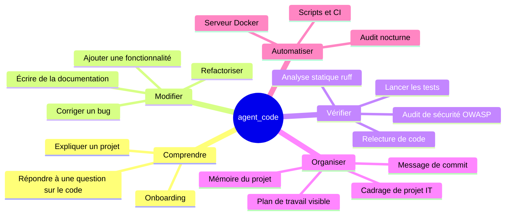
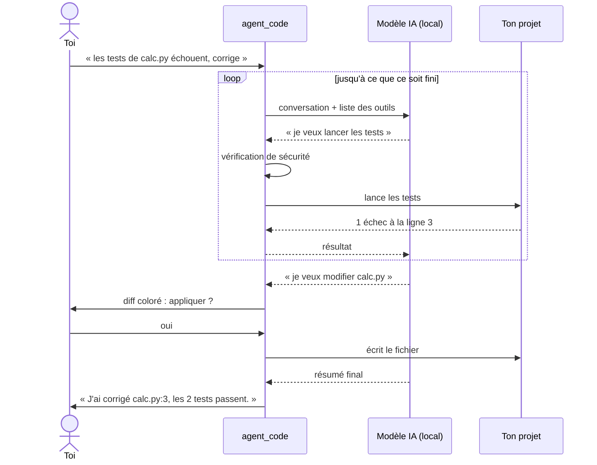

# 1. Présentation

[← Sommaire](README.md) · [Installation →](02-installation.md)

## Table des matières

- [1.1 En une phrase](#11-en-une-phrase)
- [1.2 Le problème résolu](#12-le-problème-résolu)
- [1.3 Ce que sait faire agent_code](#13-ce-que-sait-faire-agent_code)
- [1.4 Comment ça marche (sans jargon)](#14-comment-ça-marche-sans-jargon)
- [1.5 Pourquoi tout en local ?](#15-pourquoi-tout-en-local-)
- [1.6 Les garde-fous en bref](#16-les-garde-fous-en-bref)
- [1.7 Pour qui ?](#17-pour-qui-)
- [1.8 Ce qu'agent_code ne fait pas](#18-ce-quagent_code-ne-fait-pas)
- [1.9 Exemple de session](#19-exemple-de-session)
- [1.10 Glossaire](#110-glossaire)
- [1.11 Historique des versions](#111-historique-des-versions)

---

## 1.1 En une phrase

agent_code est un **assistant de programmation** que tu utilises dans ton terminal : tu lui décris ce que tu
veux (« corrige ce test », « ajoute un endpoint /health », « explique-moi l'authentification »), et il
**agit** sur ton projet comme le ferait un développeur, avec un **modèle d'IA qui tourne sur ton ordinateur**.

## 1.2 Le problème résolu

Les assistants de code du marché (Claude Code, Copilot, Cursor…) sont puissants, mais ils envoient ton code
à un serveur distant. Ce n'est pas toujours possible ni souhaitable :

| Situation | Problème avec un assistant en ligne | Réponse d'agent_code |
|---|---|---|
| Code confidentiel (client, entreprise, défense, santé) | Le code part sur un serveur tiers | Le modèle tourne sur ta machine |
| Pas de connexion / connexion limitée | L'assistant ne fonctionne pas | Fonctionne hors ligne (sauf recherche web) |
| Coût | Abonnement ou facturation à l'usage | Gratuit une fois le modèle téléchargé |
| Maîtrise | Boîte noire | Code source lisible, comportement auditable (journal d'audit) |

## 1.3 Ce que sait faire agent_code



Concrètement, il peut :

- **explorer** ton projet (arborescence, recherche dans le code, lecture de fichiers, structure des classes et fonctions) ;
- **modifier** des fichiers, en te montrant un **diff coloré** que tu acceptes, refuses ou commentes ;
- **exécuter** des commandes et les tests, avec ta validation ;
- **déléguer** une sous-tâche à un **sous-agent** spécialisé (explorateur, relecteur, testeur, chercheur web) ;
- lancer des **missions** : une équipe d'agents qui enchaîne plusieurs étapes (architecte → développeur → testeur → relecteur) et produit un rapport ;
- **se souvenir** du projet entre les sessions (fichier `AGENT_CODE.md` et notes) ;
- **annuler** tout ce qu'il a fait au tour précédent (`/annuler`), même sans git.

## 1.4 Comment ça marche (sans jargon)

Imagine un développeur assis à côté de toi, qui ne peut pas toucher ton clavier directement mais qui peut te
demander : « je peux lire ce fichier ? », « je peux remplacer ces trois lignes ? », « je peux lancer les tests ? ».

1. Tu écris ta demande.
2. Le **modèle d'IA** (un « cerveau » qui tourne localement grâce au logiciel **Ollama**) lit ta demande et
   décide de la prochaine action : lire un fichier, chercher un mot, modifier du code…
3. agent_code **exécute** cette action pour lui, **après avoir vérifié qu'elle est autorisée** (règles de
   sécurité + ta validation si nécessaire), et lui renvoie le résultat.
4. Le modèle recommence (étape 2) jusqu'à ce que la tâche soit finie, puis te fait un résumé.



## 1.5 Pourquoi tout en local ?

- Le modèle utilisé par défaut, **qwen3-coder:30b**, est téléchargé une fois (18,6 Go) puis tourne sur ton
  processeur, **même sans carte graphique** (voir [Technologies](11-technologies.md#113-qwen3-coder-et-larchitecture-moe)).
- agent_code **n'a aucune télémétrie** et **ignore les proxys** système pour parler à Ollama.
- La seule fonction qui sort sur Internet est la **recherche web** (optionnelle, désactivable avec
  `AGENT_CODE_WEB=false` ou `--sans-web`), et elle refuse d'envoyer des secrets ou des adresses internes.
- Si tu configures un serveur Ollama distant, agent_code **t'avertit** que ton code sera envoyé à cette adresse.

## 1.6 Les garde-fous en bref

| Tu crains que… | agent_code… |
|---|---|
| il modifie quelque chose sans ton accord | te montre chaque modification en diff et attend ton « oui » (mode normal) |
| il casse ton projet | garde une copie de chaque fichier modifié : `/annuler` restaure tout ; les missions font un « checkpoint » git avant de commencer |
| il sorte de ton projet | refuse tout chemin hors du dossier du projet, même via des liens symboliques |
| il lise tes mots de passe | ne peut pas lire `.env`, clés SSH, certificats… et masque les secrets qu'il croise |
| il lance une commande dangereuse | refuse d'office `sudo`, `rm -rf`, `git push`, les pipes, les redirections… |
| il tourne en boucle | limite le nombre d'étapes, bloque les appels répétés, arrête les commandes trop longues |
| tu ne saches pas ce qu'il a fait | trace toutes les actions sensibles dans un journal d'audit |

Le détail complet est dans [Sécurité](10-securite.md).

## 1.7 Pour qui ?

- **Développeurs** qui veulent un assistant agentique sans envoyer leur code dans le cloud.
- **Équipes** soumises à des contraintes de confidentialité (code client, secteur réglementé).
- **Étudiants et curieux** qui veulent comprendre comment fonctionne un agent IA : le code est court, en
  Python standard, commenté en français.
- **Administrateurs** qui veulent un audit de code automatique la nuit sur un serveur.

## 1.8 Ce qu'agent_code ne fait pas

Mieux vaut le savoir dès le départ :

- **Ce n'est pas aussi fort qu'un grand modèle en ligne.** Un modèle local de 30 milliards de paramètres est
  bon en code mais commet plus d'erreurs ; agent_code compense avec des relances automatiques et des
  vérifications (voir [Moteur](08-moteur-agentique.md#86-relances-automatiques)).
- **Ce n'est pas instantané.** Sur un processeur, compte 1,5 à 2,5 minutes pour une tâche simple
  (lire → corriger → tester).
- **Il ne pousse jamais sur un dépôt distant** (`git push` est interdit aux agents) et ne fait pas de commit
  sans toi (sauf le « checkpoint » de sauvegarde des missions).
- **Il n'exécute pas de commandes complexes** : une seule commande simple à la fois, sans pipe ni redirection.
- **Il n'est pas prévu pour Windows** en natif (fonctions POSIX : groupes de processus, `flock`, `SIGALRM`) ;
  utilise WSL ou Docker.

## 1.9 Exemple de session

```
› les tests de calc.py échouent, corrige
● Lancer_Tests()
  ⎿ CODE RETOUR: 1  (+23 lignes)
● Lire_Fichier(calc.py)
  ⎿ 📄 calc.py (lignes 1-9 / 9)  (+9 lignes)
● Modifier_Fichier(calc.py)
╭─ ✏️  Modifier calc.py  +5 −2 ─────────────────────────╮
│ -    return sum(valeurs) / len(valeurs) - 1          │
│ +    return sum(valeurs) / len(valeurs)              │
╰──────────────────────────────────────────────────────╯
Appliquer ? oui · non · toujours · ou tape une consigne › o
● Lancer_Tests()
  ⎿ CODE RETOUR: 0  (+7 lignes)
J'ai corrigé calc.py:3 (le « - 1 » faussait la moyenne) et calc.py:9 (médiane des listes paires). Les 2 tests passent.
· 95s · 5 étape(s) · 412 tokens · 16 tok/s · mémoire 14%
📝 1 fichier(s) modifié(s) : calc.py · /diff pour voir · /annuler pour revenir en arrière
```

Lecture de cet écran :

- `● Nom_Outil(argument)` : une action demandée par le modèle ;
- `⎿ …` : le résultat résumé de cette action ;
- le cadre `✏️ Modifier` : le diff à valider (vert = ajouté, rouge = supprimé) ;
- la ligne grise finale : durée, nombre d'étapes, tokens générés, vitesse, **occupation de la mémoire** du modèle.

## 1.10 Glossaire

| Terme | Définition simple |
|---|---|
| **LLM** (grand modèle de langage) | Programme d'IA entraîné sur d'énormes quantités de texte et de code, capable de générer du texte. Ici : qwen3-coder. |
| **Agent** | Un LLM à qui l'on donne des **outils** et que l'on laisse agir en boucle jusqu'à finir une tâche. |
| **Outil** | Une action précise que l'agent peut demander : `Lire_Fichier`, `Modifier_Fichier`, `Lancer_Tests`… |
| **Sous-agent** | Un agent secondaire lancé par l'agent principal pour une sous-tâche ; il ne renvoie que sa conclusion. |
| **Mission** | Une équipe d'agents spécialisés qui travaillent l'un après l'autre (ex. architecte → développeur → testeur → relecteur). |
| **Ollama** | Logiciel gratuit qui télécharge et fait tourner des modèles d'IA sur ta machine. |
| **Token** | Unité de texte manipulée par le modèle (≈ 3 à 4 caractères). Les vitesses et tailles se mesurent en tokens. |
| **Contexte / mémoire de travail** | Quantité de texte que le modèle « voit » à la fois (32 768 tokens par défaut). Au-delà, agent_code résume les anciens échanges. |
| **Prompt système** | Les instructions permanentes données au modèle (rôle, règles, description du projet). |
| **Bac à sable (sandbox)** | Le périmètre dans lequel l'agent a le droit d'agir : le dossier du projet, moins les fichiers sensibles. |
| **Diff** | Affichage des différences entre l'ancienne et la nouvelle version d'un fichier. |
| **Checkpoint** | Commit git de sauvegarde créé avant une mission, pour pouvoir tout annuler. |
| **Mode** | Niveau d'autonomie : 🛡️ normal (tu valides tout), ⚡ auto (modifications sans validation), 📖 lecture (aucune modification). |
| **MoE** (Mixture of Experts) | Architecture de modèle où seule une petite partie des paramètres travaille à chaque mot : c'est ce qui rend qwen3-coder:30b utilisable sans GPU. |
| **Injection de prompt** | Tentative de manipuler l'IA via un texte malveillant caché dans un fichier ou une page web. |

## 1.11 Historique des versions

| Version | Principe |
|---|---|
| **v1** (actuelle) | Moteur maison en Python standard, session interactive « façon Claude Code », un seul modèle (qwen3-coder:30b), fenêtre de contexte réglée à chaque requête, sous-agents, missions, sécurité renforcée, automatisation (cron, CI, Docker, systemd). Démarrage instantané, installation légère. |

---

[← Sommaire](README.md) · [Installation →](02-installation.md)
