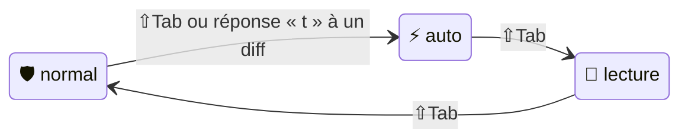
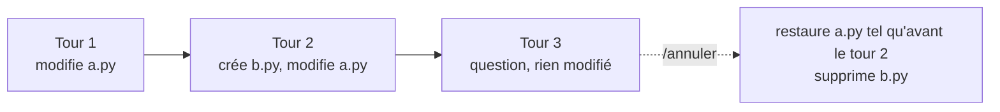
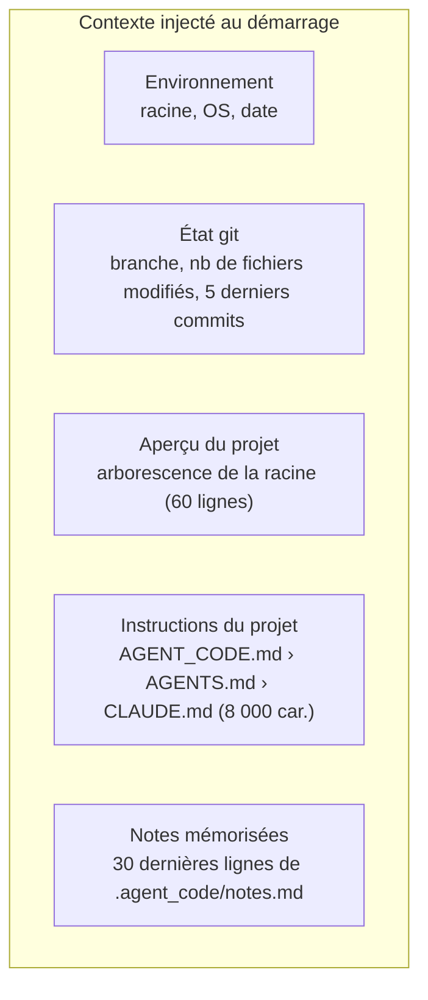

# 3. Guide d'utilisation

[← Installation](02-installation.md) · [Sommaire](README.md) · [Missions et sous-agents →](04-missions-et-sous-agents.md)

## Table des matières

- [3.1 Lancer une session](#31-lancer-une-session)
- [3.2 Formuler une demande](#32-formuler-une-demande)
- [3.3 Lire l'affichage](#33-lire-laffichage)
- [3.4 Les trois modes](#34-les-trois-modes)
- [3.5 Valider (ou refuser) une action](#35-valider-ou-refuser-une-action)
- [3.6 Joindre des fichiers : `@chemin`](#36-joindre-des-fichiers--chemin)
- [3.7 Lancer une commande soi-même : `!commande`](#37-lancer-une-commande-soi-même--commande)
- [3.8 Toutes les commandes `/`](#38-toutes-les-commandes-)
- [3.9 Raccourcis clavier](#39-raccourcis-clavier)
- [3.10 Annuler et relire les changements](#310-annuler-et-relire-les-changements)
- [3.11 La mémoire du projet : `/init`, `AGENT_CODE.md`, `/memo`](#311-la-mémoire-du-projet--init-agent_codemd-memo)
- [3.12 La mémoire de travail du modèle](#312-la-mémoire-de-travail-du-modèle)
- [3.13 Conversations : sauvegarde et reprise](#313-conversations--sauvegarde-et-reprise)
- [3.14 Committer avec `/commit`](#314-committer-avec-commit)
- [3.15 Changer de modèle](#315-changer-de-modèle)
- [3.16 Bonnes pratiques](#316-bonnes-pratiques)

---

## 3.1 Lancer une session

```bash
agent_code                         # dans le dossier courant
agent_code ~/projets/mon_api       # dans un autre projet
agent_code -c                      # reprend la dernière conversation de ce projet
agent_code --mode lecture          # démarre en mode lecture seule (modifiable en cours de session)
agent_code --lecture-seule         # lecture seule IMPOSÉE pour toute la session
agent_code --modele gpt-oss:20b    # autre modèle pour cette session
agent_code -t "explique le module auth"   # session interactive qui démarre avec cette demande
```

Le dossier passé en argument devient le **bac à sable** : l'agent ne pourra rien lire ni écrire en dehors.
agent_code refuse de démarrer sur `/`, sur ton `$HOME` entier ou sur un dossier sensible (`.ssh`, `.aws`…).

## 3.2 Formuler une demande

Écris en langage naturel, comme à un collègue :

| Type de demande | Exemple |
|---|---|
| Question | « où est géré le rafraîchissement des jetons ? » |
| Explication | « explique-moi comment marche l'authentification » |
| Correction | « ce traceback : … corrige » (colle-le directement) |
| Fonctionnalité | « ajoute un endpoint /health avec un test » |
| Revue | « relis mes changements avant que je committe » |
| Refactorisation | « renomme `get_user` en `charger_utilisateur` partout » |
| Tests | « écris des tests pour `utils/dates.py`, cas limites compris » |

Pour un texte long sur plusieurs lignes : **Échap puis Entrée** insère un retour à la ligne.

## 3.3 Lire l'affichage

```
● Rechercher_Code(« def charger » dans *.py)        ← l'agent appelle un outil
  ⎿ src/users.py:42: def charger_utilisateur(id):   ← résultat résumé (1re ligne)
◆ Deleguer(explorateur : où sont validés les jetons…)   ← délégation à un sous-agent
  │ ● Lire_Fichier(src/auth.py)                     ← actions du sous-agent, indentées
  │   ⎿ 📄 src/auth.py (lignes 1-120 / 120)
╭─ 📋 Plan ─────────────────────╮                    ← plan de travail de l'agent
│ ☑ lire le module auth         │                       ☑ fait · ◐ en cours · ☐ à faire
│ ◐ ajouter la vérification     │
│ ☐ lancer les tests            │
╰───────────────────────────────╯
⠋ Réflexion… 12s · Ctrl+C pour interrompre          ← le modèle calcule
```

Après chaque réponse, une ligne de statistiques :

```
· 95s · 5 étape(s) · 412 tokens · 16 tok/s · mémoire 14%
📝 1 fichier(s) modifié(s) : calc.py · /diff pour voir · /annuler pour revenir en arrière
```

La **barre d'état** en bas de l'écran rappelle en permanence : le mode, le modèle, l'occupation de la mémoire
(🟢 < 50 % · 🟡 < 75 % · 🔴 au-delà) et les raccourcis.

## 3.4 Les trois modes



| Mode | Modifications de fichiers | Commandes non triviales et tests | Usage typique |
|---|---|---|---|
| 🛡️ **normal** (défaut) | diff affiché, **ta validation** | ta validation | Travail quotidien |
| ⚡ **auto** | appliquées **sans validation** (`/annuler` pour revenir) | **toujours** ta validation | Tâche bien cadrée, confiance établie |
| 📖 **lecture** | **impossibles** (outils retirés) | seules les commandes d'inspection (`ls`, `git status`, `grep`…) | Explorer, comprendre, faire préparer un plan |

Changer de mode : **⇧Tab** (cycle normal → auto → lecture), ou `/mode auto`, `/mode lecture`…
Avec `--lecture-seule` au lancement, le mode lecture est imposé et ne peut pas être quitté.

Le mode est aussi expliqué au modèle dans ses instructions : en lecture, il sait qu'il doit proposer un plan
plutôt qu'essayer de modifier.

## 3.5 Valider (ou refuser) une action

Quand l'agent veut **modifier un fichier** (mode normal) :

```
╭─ ✏️  Modifier src/api.py  +3 −1 ─────────────────────╮
│ @@ -10,7 +10,9 @@                                   │
│ -    return {"status": "ok"}                         │
│ +    return {"status": "ok", "version": VERSION}     │
╰──────────────────────────────────────────────────────╯
Appliquer ? oui · non · toujours (passe en mode auto) · ou tape une consigne ›
```

Quand il veut **lancer une commande**, **les tests** ou **lire une page web** :

```
╭─ ⚙️  exécution d'une commande ─────────╮
│ 📂 /home/moi/projets/app               │
│ 👉 npm run build                       │
│ ℹ️  commande avec effets de bord possibles │
╰────────────────────────────────────────╯
Autoriser ? oui · non · t = toujours autoriser « npm run » (session) · ou tape une consigne ›
```

| Ta réponse | Effet |
|---|---|
| `o`, `oui`, `y`, ou **Entrée** | Accepté |
| `n`, `non` | Refusé ; l'agent est prévenu et doit s'adapter |
| `t`, `toujours` | Accepté, et : pour un diff → passage en **mode auto** ; pour une commande → ce **préfixe** (ex. `npm run`) est autorisé jusqu'à la fin de la session ; pour les tests / pages web → autorisés jusqu'à la fin de la session |
| **n'importe quel autre texte** | **Refus + consigne** transmise à l'agent. Ex. : « garde l'ancien nom de la fonction », « utilise pytest plutôt » |

La consigne libre est la façon la plus efficace de guider l'agent : il reçoit ton refus **avec** ton
explication et corrige le tir immédiatement.

> Certaines commandes ne peuvent **jamais** être autorisées par « toujours » ni par une liste blanche :
> le code inline (`python -c …`), les arguments qui écrivent ou exécutent (`--fix`, `-exec`, `-delete`…).
> Et les commandes **bloquées** (`sudo`, `rm -rf`, `git push`…) ne te sont même pas proposées.
> Voir [Sécurité › Politique de commandes](10-securite.md#105-politique-de-commandes).

## 3.6 Joindre des fichiers : `@chemin`

Mentionne un fichier ou un dossier avec `@` ; **Tab** complète le chemin :

```
› @src/api.py @tests/ pourquoi test_health échoue ?
📎 joint : src/api.py, tests
```

| Cible | Ce qui est joint à ta demande |
|---|---|
| Fichier texte | Son contenu (60 000 octets max, puis indication de lire la suite avec `Lire_Fichier`) |
| Dossier | Son arborescence sur 2 niveaux |
| Fichier binaire, sensible (`.env`, clé…) ou hors projet | Ignoré silencieusement |

Les secrets éventuellement présents dans un fichier joint sont **masqués** avant l'envoi au modèle.

## 3.7 Lancer une commande soi-même : `!commande`

```
› !pytest -q tests/test_api.py
╭─ $ pytest -q tests/test_api.py → code 1 ─────╮
│ F.                                            │
│ ...                                           │
╰───────────────────────────────────────────────╯
(sortie transmise à l'agent avec ta prochaine demande)
› corrige
```

- C'est **toi** qui lances la commande : elle passe par ton shell (pipes et redirections autorisés), dans le
  dossier du projet, sans la politique de sécurité des agents. Délai maximal : 5 × `AGENT_CODE_TIMEOUT_CMD`.
- La sortie (6 000 derniers caractères, secrets masqués) est **jointe à ta prochaine demande**.

## 3.8 Toutes les commandes `/`

| Commande | Effet |
|---|---|
| `/aide` (ou `/help`) | Affiche l'aide |
| `/mode [normal\|auto\|lecture]` | Change de mode (sans argument : mode suivant) |
| `/modele [nom]` | Sans argument : liste les modèles installés (taille, modèle actuel). Avec un nom : bascule sur ce modèle pour la session |
| `/annuler` | Défait les modifications de fichiers du **dernier tour** ([détails](#310-annuler-et-relire-les-changements)) |
| `/diff` | Montre tout ce que la session a modifié depuis son début |
| `/commit [message]` | Propose un message de commit et committe ([détails](#314-committer-avec-commit)) |
| `/init` | Analyse le projet et écrit/améliore `AGENT_CODE.md` |
| `/memo <note>` | Ajoute une note durable dans `.agent_code/notes.md` |
| `/contexte` | Occupation de la mémoire de travail, nombre de messages, statistiques de la session |
| `/compacter [consigne]` | Résume la conversation pour libérer de la mémoire (consigne optionnelle : « garde le détail des tests ») |
| `/effacer` (ou `/clear`) | Nouvelle conversation (l'ancienne reste disponible dans `/reprendre`) |
| `/reprendre [n]` | Liste les 10 dernières conversations et en reprend une |
| `/missions` | Liste les missions multi-agents |
| `/mission <nom> <demande>` | Lance une mission ([Missions](04-missions-et-sous-agents.md)) |
| `/quitter` (ou `/q`, `/exit`, `exit`, Ctrl+D) | Quitte (la conversation est sauvegardée) |

Une commande mal tapée affiche des suggestions (« tu voulais dire /mode, /modele ? »).

## 3.9 Raccourcis clavier

| Raccourci | Effet |
|---|---|
| **⇧Tab** | Change de mode : normal → auto → lecture |
| **Tab** | Complète une `/commande`, un mode après `/mode `, ou un `@chemin` |
| **Échap puis Entrée** | Nouvelle ligne dans la demande |
| **Ctrl+C** pendant que l'agent travaille | Interrompt le tour en cours ; la conversation reste cohérente et continue |
| **Ctrl+C** deux fois en moins de 2 s à l'invite | Quitte |
| **Ctrl+D** | Quitte |
| **↑ / ↓** | Historique des demandes (conservé dans `~/.local/share/agent_code/historique`) |

## 3.10 Annuler et relire les changements

agent_code mémorise, **tour par tour**, le contenu d'origine de chaque fichier qu'il modifie ou crée.



- `/annuler` restaure les fichiers du **dernier tour qui a modifié quelque chose** : fichiers modifiés remis
  dans leur état d'avant, fichiers créés supprimés. On peut l'appeler plusieurs fois pour remonter tour par tour.
- L'agent est informé de l'annulation dans ta demande suivante.
- `/diff` affiche le diff complet entre le début de la session et maintenant (60 000 caractères max).
- Fonctionne **avec ou sans git**.

Limites à connaître :

- seules les écritures faites par les outils `Ecrire_Fichier` et `Modifier_Fichier` sont suivies — **pas** les
  effets des commandes (`npm install`, formateurs, scripts…) ;
- un fichier de plus de 5 Mo n'est pas mémorisé (il n'est alors pas restauré) ;
- l'historique d'annulation vit en mémoire : il est perdu en quittant la session.

## 3.11 La mémoire du projet : `/init`, `AGENT_CODE.md`, `/memo`

À chaque session, agent_code construit un **contexte du projet** injecté dans les instructions du modèle :



**`AGENT_CODE.md`** — la mémoire « officielle » du projet, écrite par toi ou par `/init` :

```bash
› /init
```

L'agent explore le projet et écrit (ou améliore sans rien perdre) un fichier de 60 lignes maximum avec les
sections : Objectif · Stack et dépendances clés · Commandes (installer, lancer, tester, linter — vérifiées) ·
Architecture · Conventions · Pièges et points d'attention. Tu peux ensuite l'éditer à la main.
`/init` nécessite le mode normal ou auto. Si `AGENT_CODE.md` n'existe pas, `AGENTS.md` puis `CLAUDE.md` sont
utilisés à la place (compatibilité avec d'autres outils).

**`/memo`** — des notes rapides et datées :

```
› /memo on utilise pytest-asyncio, pas anyio
✅ Note enregistrée.
```

L'agent peut aussi prendre des notes lui-même (outil `Noter_Memo`). Les notes sont présentées au modèle comme
**informations de contexte, pas comme des instructions** (protection contre l'injection de prompt).

## 3.12 La mémoire de travail du modèle

Le modèle ne « voit » qu'une quantité limitée de texte à la fois : 32 768 tokens par défaut
(`AGENT_CODE_CONTEXTE`). agent_code gère cette limite automatiquement :

| Occupation | Ce qui se passe |
|---|---|
| < 70 % | Rien |
| ≥ 70 % | Les **anciens résultats d'outils** (hors 8 derniers messages) sont raccourcis à 400 caractères |
| toujours ≥ 70 % | 🗜️ **Résumé automatique** des anciens échanges (objectifs, décisions, fichiers, avancement) |

Tu peux suivre l'occupation dans la barre d'état ou avec `/contexte`, et forcer un résumé avec `/compacter`.
Le détail technique est dans [Moteur › Gestion de la mémoire](08-moteur-agentique.md#87-gestion-de-la-mémoire-de-travail).

## 3.13 Conversations : sauvegarde et reprise

- Chaque conversation est sauvegardée après chaque tour dans `.agent_code/sessions/<date>_<id>.json`
  (messages, résumé, plan, modèle, mode). Les **50** plus récentes sont conservées.
- `agent_code -c` reprend la plus récente ; `/reprendre` permet de choisir parmi les 10 dernières.
- `/effacer` démarre une conversation vierge (utile quand on change de sujet : la mémoire repart de zéro).

## 3.14 Committer avec `/commit`

```
› /commit
 M src/api.py
?? tests/test_health.py
⠋ Réflexion…
╭─ Message de commit ──────────────────────────╮
│ Ajoute l'endpoint /health avec son test      │
│                                              │
│ - Renvoie le statut et la version de l'API   │
│ - Nouveau test tests/test_health.py          │
╰──────────────────────────────────────────────╯
Committer ? oui · non · e = écrire un autre message ›
```

- Sans argument, le modèle rédige le message à partir du diff (en français, première ligne à l'impératif
  ≤ 72 caractères, puis 1 à 5 puces). Avec un argument (`/commit Corrige le calcul`), ce message est utilisé tel quel.
- Les **fichiers sensibles** (`.env`, clés, `*secret*`…) sont **exclus** du `git add`.
- Le commit est fait **en ton nom** : tes hooks git (`pre-commit`…) s'exécutent normalement.
- agent_code ne fait **jamais** de `git push`.

## 3.15 Changer de modèle

```
› /modele
  gpt-oss:20b                               13.8 Go
  qwen3-coder:30b                           18.6 Go ← actuel
› /modele gpt-oss:20b
🧠 Modèle : gpt-oss:20b (pour changer durablement : AGENT_CODE_MODELE dans la config)
```

Le changement vaut pour la session. N'utilise qu'un modèle à la fois : Ollama garde en mémoire celui qu'il a
chargé, et en alterner deux est très lent (voir `ollama ps` / `ollama stop`).

## 3.16 Bonnes pratiques

1. **Commence par `/init`** sur un nouveau projet : c'est le meilleur gain de pertinence.
2. **Sois précis** : nomme les fichiers (`@src/api.py`), colle le message d'erreur complet, décris le résultat attendu.
3. **Découpe** les grosses demandes : « ajoute le modèle », puis « ajoute l'endpoint », puis « ajoute les tests ».
4. **Réponds par une consigne** plutôt que par un simple « non » quand un diff ne te convient pas.
5. **Utilise le mode lecture** pour faire préparer un plan, puis repasse en normal pour l'exécuter.
6. **Surveille la mémoire** : au-delà de 75 %, `/compacter` ou `/effacer` si tu changes de sujet.
7. **Travaille sur un dépôt git propre** : tu pourras toujours comparer et revenir en arrière.
8. **Interromps sans hésiter** (Ctrl+C) si l'agent part dans une mauvaise direction : la conversation reste utilisable.

---

[← Installation](02-installation.md) · [Sommaire](README.md) · [Missions et sous-agents →](04-missions-et-sous-agents.md)
