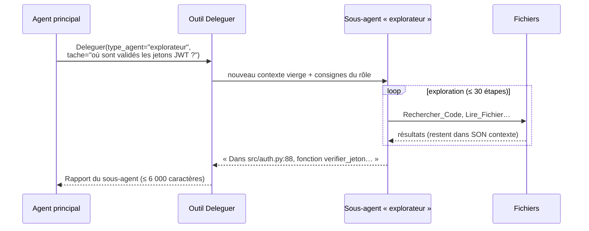
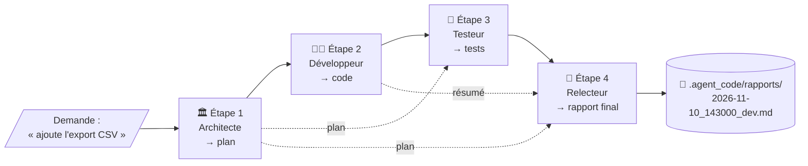
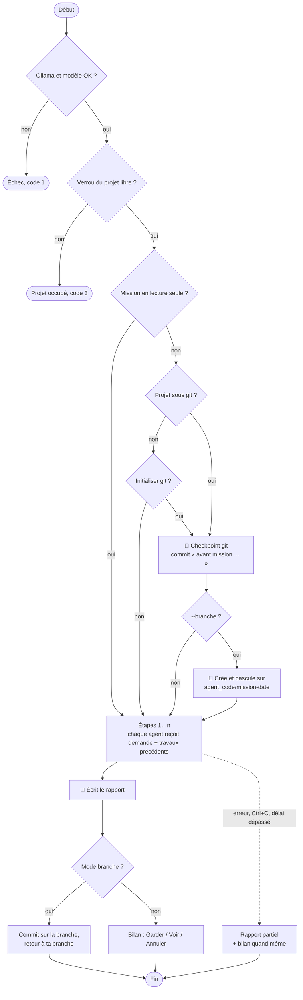

# 4. Missions et sous-agents

[← Guide d'utilisation](03-guide-utilisateur.md) · [Sommaire](README.md) · [Automatisation →](05-automatisation.md)

## Table des matières

- [4.1 Deux mécanismes complémentaires](#41-deux-mécanismes-complémentaires)
- [4.2 Les sous-agents](#42-les-sous-agents)
- [4.3 Les missions](#43-les-missions)
- [4.4 Catalogue détaillé des missions](#44-catalogue-détaillé-des-missions)
- [4.5 Les rôles des agents de mission](#45-les-rôles-des-agents-de-mission)
- [4.6 Déroulement d'une mission](#46-déroulement-dune-mission)
- [4.7 Filet de sécurité : checkpoint, bilan, branche](#47-filet-de-sécurité--checkpoint-bilan-branche)
- [4.8 Rapports](#48-rapports)
- [4.9 Lancer une mission](#49-lancer-une-mission)

---

## 4.1 Deux mécanismes complémentaires

| | **Sous-agent** | **Mission** |
|---|---|---|
| Qui le déclenche ? | L'agent principal, de lui-même (outil `Deleguer`) | Toi (`/mission` ou `-m`) |
| Nombre d'agents | 1 sous-agent pour 1 sous-tâche | 1 à 4 agents qui se succèdent |
| Objectif | Économiser la mémoire de l'agent principal | Traiter une tâche complète avec des rôles spécialisés |
| Résultat | Un rapport (≤ 6 000 caractères) renvoyé à l'agent principal | Un rapport Markdown dans `.agent_code/rapports/` |
| Filet de sécurité | Celui de la session (diff, `/annuler`) | Checkpoint git + bilan Garder / Voir / Annuler (+ option `--branche`) |

## 4.2 Les sous-agents

Avec une mémoire de travail limitée (32k tokens), lire dix fichiers pour répondre à une question
remplirait vite la conversation. L'agent principal peut donc **déléguer** : un sous-agent travaille dans **son
propre contexte**, puis ne renvoie que sa **conclusion**.



| Sous-agent | Rôle | Outils | Écrit ? |
|---|---|---|---|
| 🔎 `explorateur` | Répond à **une** question précise sur le code (où, comment, quoi), avec preuves `fichier:ligne` | Lecture + git (lecture) | Non |
| 🧐 `relecteur` | Relit des changements (`Git_Diff`) ou des fichiers ; classe les problèmes 🔴/🟠/🟢 avec correctif ; verdict ✅ prêt / ⚠️ à reprendre | Lecture + git + `Analyser_Qualite` | Non |
| 🧪 `testeur` | Écrit des tests ciblés (nominal, limites, erreurs), les lance, rapporte la sortie exacte ; ne touche pas au code de production | Lecture + git + écriture + `Verifier_Syntaxe` + `Lancer_Tests` + `Analyser_Qualite` | Oui (fichiers de test) |
| 🌐 `chercheur` | Recherche web (doc officielle d'abord) et synthèse sourcée ; n'envoie jamais de code ni de donnée privée | `Recherche_Web`, `Lire_Page_Web` | Non |

Points importants :

- le sous-agent **ne voit pas ta conversation** : l'agent principal doit lui décrire la tâche précisément ;
- il hérite du même projet, du même contexte (`AGENT_CODE.md`, notes…) et des **mêmes règles de sécurité** ;
- ses actions s'affichent indentées (`│`) et ses écritures passent par la **même validation** que l'agent principal ;
- `chercheur` n'existe que si le web est activé ; en mode lecture, `testeur` perd ses outils d'écriture ;
- limite : 30 étapes par sous-agent (ou `AGENT_CODE_MAX_ETAPES` si plus petit).

## 4.3 Les missions

Une **mission** est une recette : une suite d'**étapes**, chacune confiée à un **agent spécialisé** (un rôle
avec ses consignes et sa boîte à outils). Chaque étape reçoit la demande initiale **et le travail des étapes
précédentes** qu'elle doit connaître.



## 4.4 Catalogue détaillé des missions

| Clé | Mission | Étapes (agents) | Accès | Web |
|---|---|---|---|---|
| `dev` | 🛠️ Développer une fonctionnalité | architecte → developpeur → testeur → relecteur | écriture | optionnel |
| `debug` | 🐞 Corriger un bug | debogueur → relecteur | écriture | optionnel |
| `revue` | 🔍 Audit qualité & sécurité | relecteur → securite | 🔒 lecture seule | optionnel |
| `tests` | 🧪 Écrire des tests | architecte → testeur | écriture | optionnel |
| `doc` | 📚 Documenter le projet | architecte → documentaliste | écriture | optionnel |
| `explique` | 🧭 Comprendre un projet / du code | architecte | 🔒 lecture seule | optionnel |
| `question` | 💬 Question rapide sur le code | architecte | 🔒 lecture seule | optionnel |
| `projet` | 📋 Cadrer un projet IT | chercheur → chef_projet | 🔒 lecture seule | optionnel |
| `veille` | 🌐 Veille / recherche technique | chercheur | 🔒 lecture seule | **requis** |
| `devops` | 🚢 DevOps / CI / Docker | devops → securite | écriture | optionnel |

### `dev` — Développer une fonctionnalité

| # | Agent | Consigne | Résultat attendu | Reçoit |
|---|---|---|---|---|
| 1 | Architecte | Explorer (arborescence, signatures, recherche) et produire un plan d'implémentation : fichiers à créer/modifier, changements, points d'attention (sécurité, compatibilité), vérification | Plan numéroté, fichier par fichier | — |
| 2 | Développeur | Implémenter le plan : lire, modifier, vérifier la syntaxe ; rien hors du plan sans justification | Fichiers modifiés + résumé + résultat des vérifications | 1 |
| 3 | Testeur | Écrire/compléter les tests, les lancer ; si un test échoue à cause du code, correctif minimal et relance | Tests ajoutés + sortie exacte | 1, 2 |
| 4 | Relecteur | Relire tout le diff : respect du plan, régressions, failles | Rapport classé par gravité + verdict ✅ / ⚠️ | 1, 2, 3 |

### `debug` — Corriger un bug

| # | Agent | Consigne | Résultat attendu |
|---|---|---|---|
| 1 | Débogueur | Localiser (recherche, traceback), reproduire, identifier la **cause racine**, correctif minimal, vérifier (syntaxe + tests) | Cause expliquée, correctif `fichier:ligne`, preuve |
| 2 | Relecteur | Le correctif est-il correct, minimal, sans effet de bord ? Proposer un test de non-régression s'il manque | Verdict de revue |

Astuce : colle le traceback dans un fichier et lance `agent_code . -m debug -T traceback.txt`.

### `revue` — Audit qualité & sécurité (lecture seule)

| # | Agent | Consigne |
|---|---|---|
| 1 | Relecteur | Revue qualité : architecture, lisibilité, duplication, gestion d'erreurs, tests manquants, performances, dette technique ; lance `Analyser_Qualite` ; constats 🔴/🟠/🟢 avec `fichier:ligne` et correctif |
| 2 | Sécurité | Audit OWASP Top 10, secrets, dépendances, configurations ; traque `eval`, `exec`, `shell=True`, `pickle`, `password=`, `verify=False`… ; rapport consolidé + plan de remédiation priorisé |

C'est la mission utilisée pour l'**audit nocturne** (voir [Automatisation](05-automatisation.md#56-audit-nocturne-avec-systemd)).

### `tests` — Écrire des tests

1. **Architecte** : identifie le code non ou mal testé, liste les cas prioritaires (nominal, limites, erreurs), choisit le framework.
2. **Testeur** : écrit les tests, les lance, itère ; **ne modifie pas le code de production** et signale les bugs découverts.

### `doc` — Documenter le projet

1. **Architecte** : synthèse factuelle (objectif, stack, points d'entrée, installation, configuration, architecture, flux).
2. **Documentaliste** : rédige et écrit la documentation demandée, **sans perdre** les informations utiles d'une doc existante.

### `explique` et `question` (lecture seule)

- `explique` : explication pédagogique — vue d'ensemble, composants clés (`fichier:ligne`), flux de données, points d'attention, glossaire, schéma Mermaid ou ASCII si utile.
- `question` : un seul agent, réponse courte et sourcée.

### `projet` — Cadrer un projet IT (lecture seule)

1. **Chercheur** : 2–3 options technologiques par brique, avantages/inconvénients, maturité, coût (recherche web si disponible).
2. **Chef de projet** : dossier de cadrage complet — objectifs SMART, périmètre et MVP, exigences fonctionnelles et non fonctionnelles, architecture cible (Mermaid), backlog (épopées → user stories avec critères d'acceptation et estimation), planning par sprints, risques (probabilité, impact, mitigation), prochaines actions.

### `veille` — Recherche technique (web requis)

Un **chercheur** fait plusieurs recherches, lit les pages pertinentes et rédige une synthèse : contexte,
options, tableau comparatif, recommandation, sources (URL).

### `devops` — DevOps / CI / Docker

1. **DevOps** : analyse la stack, crée/modifie Dockerfile, compose, CI, Makefile… selon les bonnes pratiques (non-root, versions épinglées, cache, secrets en variables), vérifie la syntaxe YAML/TOML/JSON.
2. **Sécurité** : revue de la configuration produite (images, secrets, permissions CI, chaîne d'approvisionnement).

## 4.5 Les rôles des agents de mission

| Rôle (clé) | Intitulé | Outils (moindre privilège) | Modèle / température |
|---|---|---|---|
| `architecte` | Architecte Logiciel | Lecture, git, `Noter_Memo` (+ web) | réflexion |
| `developpeur` | Développeur Senior | Lecture, git, écriture, `Verifier_Syntaxe`, `Executer_Commande`, `Analyser_Qualite` | code |
| `testeur` | Ingénieur QA | Lecture, git, écriture, `Verifier_Syntaxe`, `Lancer_Tests`, `Analyser_Qualite` | code |
| `relecteur` | Relecteur de Code | Lecture, git, `Analyser_Qualite`, `Noter_Memo` | réflexion |
| `securite` | Auditeur Sécurité (AppSec) | Lecture, git, `Analyser_Qualite`, `Executer_Commande` (+ web) | réflexion |
| `documentaliste` | Rédacteur Technique | Lecture, écriture | réflexion |
| `chef_projet` | Chef de Projet IT | Lecture, git, `Noter_Memo` (+ web) | réflexion |
| `chercheur` | Veilleur Technologique | Lecture (+ web) | réflexion |
| `devops` | Ingénieur DevOps | Lecture, écriture, `Verifier_Syntaxe`, `Executer_Commande` (+ web) | code |
| `debogueur` | Expert Débogage | Lecture, git, `Modifier_Fichier`, `Verifier_Syntaxe`, `Executer_Commande`, `Lancer_Tests` (+ web) | code |

- « Lecture » = `Lister_Arborescence`, `Trouver_Fichiers`, `Lire_Fichier`, `Rechercher_Code`, `Extraire_Signatures` ;
  « git » = `Git_Etat`, `Git_Diff` ; « écriture » = `Ecrire_Fichier`, `Modifier_Fichier` ; « web » = `Recherche_Web`, `Lire_Page_Web`.
- Tous ont en plus `Mettre_A_Jour_Plan` et peuvent déléguer au sous-agent `explorateur`.
- « réflexion » = `AGENT_CODE_MODELE_REFLEXION` + `AGENT_CODE_TEMPERATURE_REFLEXION` (0,5) ; « code » =
  `AGENT_CODE_MODELE_CODE` + `AGENT_CODE_TEMPERATURE_CODE` (0,3). Par défaut, le **même modèle** sert aux deux.
- Dans une mission en lecture seule, les outils d'écriture et `Lancer_Tests` sont retirés à tous les agents.

## 4.6 Déroulement d'une mission



Détails :

- la demande est tronquée à 8 000 caractères ; le travail transmis de chaque étape précédente à 8 000 caractères ;
- un agent qui ne rend rien et rencontre une erreur arrête la mission ;
- **même en cas d'erreur, de Ctrl+C ou de délai dépassé**, agent_code écrit un rapport partiel
  (« ⚠️ Mission incomplète ») et te montre ce qui a changé ;
- en fin de mission : durée, tokens générés et chemin du rapport sont affichés.

Pendant une mission lancée en ligne de commande, les écritures de fichiers sont appliquées **sans diff à
valider** (le filet est le checkpoint git + bilan). Une mission lancée avec `/mission` depuis une session
interactive suit le **mode courant** de la session (en mode normal, tu valides chaque diff). Dans les deux
cas, les commandes et les tests restent soumis à validation.

## 4.7 Filet de sécurité : checkpoint, bilan, branche

**Checkpoint.** Avant toute mission qui peut écrire, agent_code crée un commit de sauvegarde
`[agent_code] avant mission dev : …` contenant l'état actuel du projet (y compris tes modifications non
commitées). Sont exclus : les fichiers sensibles (`.env`, clés…), `.agent_code/` et les fichiers non suivis de
plus de 20 Mo. Ce commit est fait sans hooks ni signature, avec l'identité `agent_code <agent_code@localhost>`
si tu n'as pas configuré la tienne. Si le projet n'est pas sous git, agent_code propose de l'initialiser.

**Bilan** (mode interactif) — à la fin :

```
📝 MODIFICATIONS EFFECTUÉES PAR AGENT_CODE
 src/export.py        | 42 ++++++++++
 tests/test_export.py | 31 +++++++
Nouveaux fichiers :
  src/export.py

[G]arder  /  [V]oir le diff  /  [A]nnuler (mis de côté dans git stash)  ?
```

| Choix | Effet |
|---|---|
| `G` ou Entrée | Les modifications restent ; pense à relire puis committer |
| `V` | Affiche le diff (secrets masqués, 30 000 caractères max), puis redemande |
| `A` | `git stash push -u` : tout est **mis de côté**, récupérable avec `git stash list` / `git stash pop` |

Sans terminal, les modifications sont conservées et la référence du checkpoint est affichée
(annulation manuelle : `git stash -u`).

**Mode `--branche`** (ligne de commande) : le travail est isolé dans une branche
`agent_code/<mission>-<AAAA-MM-JJ_HHMMSS>`. À la fin, il y est committé, puis agent_code **revient sur ta
branche d'origine**, qui n'a pas bougé :

```
🌿 Modifications dans la branche agent_code/dev-2026-11-10_143000 (ta branche n'a pas bougé).
   Voir : git diff 3f2a9c1e07..agent_code/dev-2026-11-10_143000   Fusionner : git merge agent_code/dev-2026-11-10_143000
```

Si la mission n'a rien modifié, la branche vide est supprimée. Idéal pour les missions lancées sans surveillance.

## 4.8 Rapports

Chaque mission écrit `.agent_code/rapports/<AAAA-MM-JJ_HHMMSS>_<clé>.md` :

```markdown
# 🔍 Audit qualité & sécurité

> Demande : tout le projet

## Résumé
...
## Détails
...
## Fichiers concernés
...
## Prochaines étapes recommandées
...
```

Le rapport contient la sortie de la **dernière** étape (qui synthétise les précédentes). En cas d'arrêt
prématuré, il contient toutes les sorties obtenues, séparées par `---`, suivies de « ⚠️ Mission incomplète ».
Le dossier `.agent_code/` est automatiquement exclu de git (via `.git/info/exclude`, sans toucher à ton `.gitignore`).

## 4.9 Lancer une mission

```bash
# En session interactive
› /missions
› /mission revue le module api/
› /mission dev                 # sans demande : elle est demandée ensuite

# En ligne de commande
agent_code --liste                                   # liste les missions
agent_code . -m revue -t "tout le projet"
agent_code . -m debug -T traceback.txt               # demande lue dans un fichier
cat erreur.log | agent_code . -m debug -T -          # demande lue sur l'entrée standard
agent_code . -m dev -t "export CSV" --branche --autoriser-tests --json
agent_code . -m dev                                  # en terminal : la demande est posée ensuite
```

Sans `-m`, `agent_code` ouvre la session interactive. Avec `-m <clé>` mais sans `-t`/`-T`, la demande est
posée au clavier (invite propre à chaque mission) ; sans terminal, `-t` ou `-T` est obligatoire.

Options utiles pour les missions : `--branche`, `--timeout-mission`, `--sans-web`, `--lecture-seule`,
`--autoriser-tests`, `--autoriser-cmd`, `--json`. Voir [Automatisation](05-automatisation.md).

---

[← Guide d'utilisation](03-guide-utilisateur.md) · [Sommaire](README.md) · [Automatisation →](05-automatisation.md)
