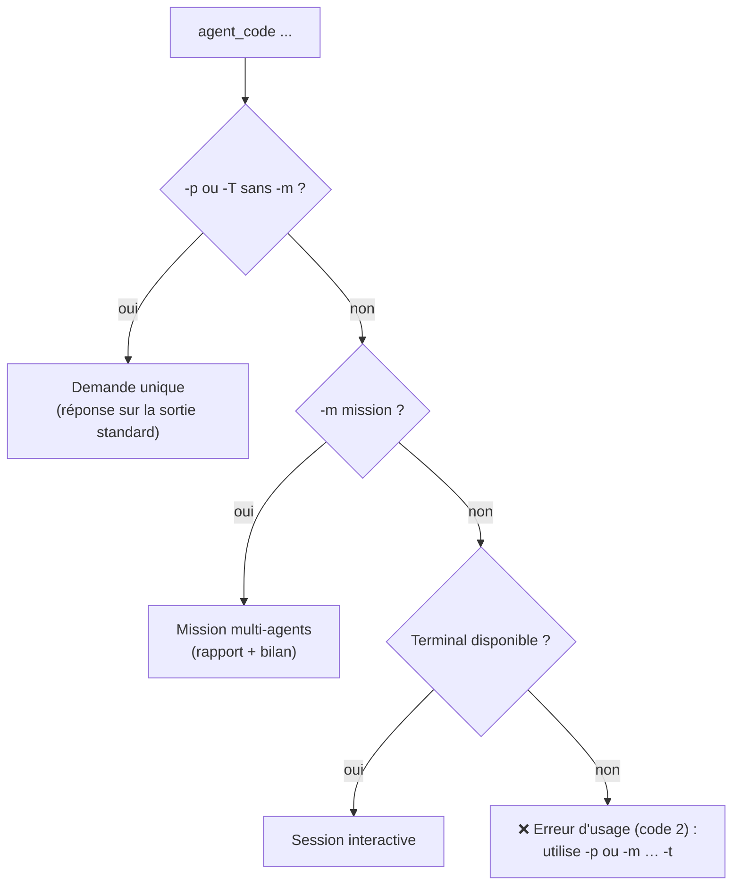
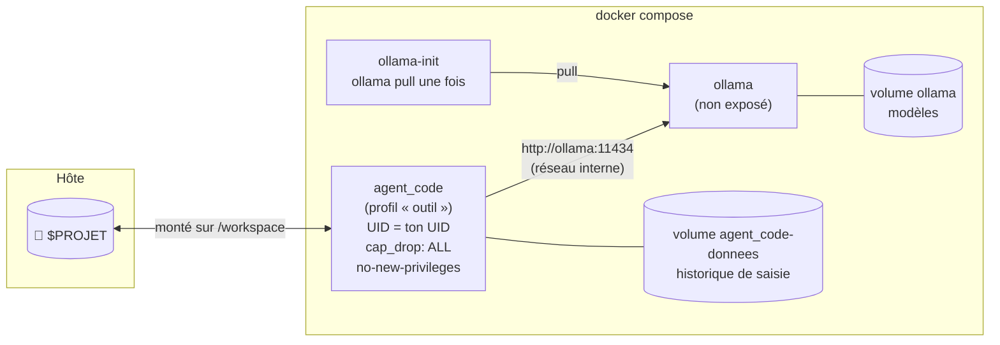

# 5. Automatisation : scripts, cron, CI, serveur

[← Missions et sous-agents](04-missions-et-sous-agents.md) · [Sommaire](README.md) · [Configuration →](06-configuration.md)

## Table des matières

- [5.1 Les trois façons de lancer agent_code](#51-les-trois-façons-de-lancer-agent_code)
- [5.2 Règle d'or du mode sans surveillance](#52-règle-dor-du-mode-sans-surveillance)
- [5.3 Une demande, une réponse : `-p`](#53-une-demande-une-réponse---p)
- [5.4 Missions sans surveillance](#54-missions-sans-surveillance)
- [5.5 Sortie JSON et codes de sortie](#55-sortie-json-et-codes-de-sortie)
- [5.6 Audit nocturne avec systemd](#56-audit-nocturne-avec-systemd)
- [5.7 Docker](#57-docker)
- [5.8 Exemples d'intégration (cron, CI, hook git)](#58-exemples-dintégration-cron-ci-hook-git)
- [5.9 Ollama distant](#59-ollama-distant)
- [5.10 Verrou de projet](#510-verrou-de-projet)

---

## 5.1 Les trois façons de lancer agent_code



| Mode | Commande | Pour |
|---|---|---|
| Session interactive | `agent_code [dossier]` | Usage quotidien |
| Demande unique | `agent_code -p "…"` | Scripts, alias, questions rapides |
| Mission | `agent_code [dossier] -m <clé> -t "…"` | Tâches complètes, cron, CI, serveur |

## 5.2 Règle d'or du mode sans surveillance

> **Sans terminal (cron, CI, pipe), toute action qui demande une validation est REFUSÉE** — sauf ce que tu
> autorises explicitement.

agent_code détecte l'absence de terminal (`stdin` n'est pas un TTY, ou la demande est lue sur l'entrée
standard avec `-T -`). Dans ce cas :

| Action | Comportement par défaut sans terminal | Pour l'autoriser |
|---|---|---|
| Commandes d'inspection (`ls`, `git status`, `grep`…) | ✅ exécutées | — (désactivable : `--confirmer-tout`) |
| Modification de fichiers, demande unique `-p` | ⛔ refusée ; l'agent est invité à **décrire** les changements | `--mode auto` |
| Modification de fichiers, mission `-m` | ✅ appliquée (filet : checkpoint git) | — (empêcher : `--lecture-seule`) |
| Lancement des tests | ⛔ refusé | `--autoriser-tests` ou `AGENT_CODE_AUTORISER_TESTS=true` |
| Autre commande | ⛔ refusée | `--autoriser-cmd "préfixe exact"` (répétable) ou `AGENT_CODE_COMMANDES_AUTORISEES` |
| Lecture d'une page web | ⛔ refusée | `AGENT_CODE_AUTORISER_PAGES_WEB=true` |
| Commandes **bloquées** (`sudo`, `rm -rf`, `git push`…) | ⛔ toujours | **impossible** |
| Code inline (`python -c`), arguments qui écrivent/exécutent (`--fix`, `-exec`…) | ⛔ toujours | **impossible** par liste blanche |

**Liste blanche** : la comparaison se fait **mot par mot** sur le début de la commande.
`--autoriser-cmd "npm run lint"` autorise `npm run lint -- --quiet`, mais pas `npm run build`, ni
`./npm run lint`, ni `npm-evil`. Chaque refus est tracé dans le journal d'audit (`REFUS_NON_INTERACTIF`).

## 5.3 Une demande, une réponse : `-p`

```bash
agent_code -p "explique le module auth" --mode lecture
agent_code -p "corrige le lint" --mode auto --autoriser-cmd "ruff check"
agent_code ~/projets/api -p "quelles routes ne sont pas testées ?" --json
agent_code -T question.md                      # demande lue dans un fichier (sans -m : demande unique)
```

- La demande est limitée à 20 000 caractères.
- Le verrou de projet est pris pendant l'exécution.
- En mode `normal` sans terminal, les écritures sont refusées : utilise `--mode auto` si tu veux que l'agent
  modifie, ou `--mode lecture` pour être certain qu'il ne touche à rien.
- `--json` ajoute en **dernière ligne** :

```json
{"statut": "ok", "reponse": "Les routes /admin et /export…", "fichiers_modifies": []}
```

## 5.4 Missions sans surveillance

```bash
agent_code ~/projets/api -m revue -t "tout le projet, en priorité les changements récents" \
  --sans-web --json --timeout-mission 3600

agent_code ~/projets/api -m dev -T demande.md \
  --branche --autoriser-tests --autoriser-cmd "ruff check" --timeout-mission 3600 --json
```

Au démarrage, agent_code affiche un récapitulatif :

```
✻ AGENT_CODE v1.0 — mission dev
🔒 Bac à sable : /home/moi/projets/api
🧠 Modèle      : qwen3-coder:30b
⚙️  Options     : web=oui | lecture seule=non | branche=oui | délai max=3600s
🤖 Sans surveillance : validations refusées sauf tests, ruff check.
```

Recommandations pour les missions sans surveillance :

| Option | Pourquoi |
|---|---|
| `--branche` | Ta branche ne bouge jamais ; le travail est relu et fusionné quand tu veux |
| `--timeout-mission 3600` | Évite une mission bloquée indéfiniment (code 124 si dépassé) |
| `--json` | Résultat exploitable par un script |
| `--sans-web` | Aucune sortie réseau |
| `--autoriser-tests` | Sinon le testeur ne peut pas lancer les tests |
| `--lecture-seule` | Pour un audit garanti sans modification |

**Délai de mission** : géré par un signal `SIGALRM`. À l'expiration, la mission s'arrête proprement, un
rapport partiel est écrit, le bilan est fait, et l'événement `MISSION_TIMEOUT` est tracé.

## 5.5 Sortie JSON et codes de sortie

**JSON d'une mission** (dernière ligne de la sortie avec `--json`) :

```json
{
  "mission": "dev",
  "statut": "ok",
  "rapport": "/home/moi/projets/api/.agent_code/rapports/2026-11-10_030000_dev.md",
  "duree_s": 812,
  "tokens": 9431,
  "reference_git": "3f2a9c1e07b4…",
  "branche": "agent_code/dev-2026-11-10_030000",
  "fichiers_modifies": ["src/export.py", "tests/test_export.py"],
  "erreur": ""
}
```

| Champ | Signification |
|---|---|
| `statut` | `ok` · `erreur` · `interrompue` · `timeout` (ou `occupe` si le verrou est pris) |
| `rapport` | Chemin du rapport Markdown |
| `duree_s`, `tokens` | Durée en secondes, tokens générés (ou `null`) |
| `reference_git` | SHA du checkpoint pris avant la mission (`null` en lecture seule / sans git) |
| `branche` | Branche contenant le travail (`--branche`), ou `null` |
| `fichiers_modifies` | Fichiers modifiés ou créés depuis le checkpoint (hors `.agent_code/`) |
| `erreur` | Type et message de l'erreur éventuelle |

**Codes de sortie** :

| Code | Signification |
|---|---|
| `0` | Succès |
| `1` | Échec (Ollama injoignable, modèle absent, mission en erreur, diagnostic en erreur) |
| `2` | Erreur d'usage ou de configuration (dossier invalide, demande manquante sans terminal, mission nécessitant le web désactivé…) |
| `3` | Projet occupé : une autre mission tourne déjà dessus |
| `124` | Délai de mission dépassé |
| `130` | Interrompu (Ctrl+C) |

## 5.6 Audit nocturne avec systemd

Le dépôt fournit `deploy/systemd/agent_code-revue.service` et `agent_code-revue.timer` : une mission `revue`
(lecture seule, sans web, délai 1 h, sortie JSON) **chaque nuit à 3 h** (± 15 min aléatoires, rattrapée au
démarrage si la machine était éteinte).

```bash
mkdir -p ~/.config/systemd/user && cp deploy/systemd/agent_code-revue.* ~/.config/systemd/user/
systemctl --user edit agent_code-revue.service     # adapte le projet à auditer (voir ci-dessous)
systemctl --user daemon-reload && systemctl --user enable --now agent_code-revue.timer
loginctl enable-linger "$USER"                      # pour tourner même session fermée (serveur)
```

Dans l'éditeur ouvert par `systemctl --user edit`, ajoute :

```ini
[Service]
Environment=PROJET=/home/moi/projets/mon_app
```

Suivi :

```bash
systemctl --user list-timers | grep agent_code      # prochaine exécution
systemctl --user start agent_code-revue.service      # lancer tout de suite
journalctl --user -u agent_code-revue -f             # journal
ls <projet>/.agent_code/rapports/                    # rapports
```

Le service est durci : priorité basse (`Nice=10`, E/S en `idle`) et `NoNewPrivileges=true`.

## 5.7 Docker



```bash
make docker                     # = AGENT_CODE_UID=$(id -u) docker compose --profile outil build agent_code
                                #   + docker compose up -d ollama
PROJET=~/projets/app docker compose run --rm agent_code                       # session interactive
PROJET=~/projets/app docker compose run --rm agent_code -m revue -t "tout"    # mission
docker compose run --rm agent_code --diagnostic
```

| Élément | Détail |
|---|---|
| Image | `python:3.12-slim` + git ; installe `.[outils]` ; utilisateur non-root `agent_code` |
| UID | Construite avec **ton UID** (`AGENT_CODE_UID`) : les fichiers créés t'appartiennent et git n'émet pas d'alerte « dubious ownership » |
| Ollama | Service `ollama`, **non exposé** sur le réseau (décommente `ports: ["127.0.0.1:11434:11434"]` pour y accéder depuis l'hôte) ; `healthcheck` sur `ollama list` |
| Modèle | `ollama-init` télécharge `AGENT_CODE_MODELE` (défaut `qwen3-coder:30b`) une seule fois |
| Sécurité | `cap_drop: [ALL]`, `no-new-privileges:true`, Ollama marqué « de confiance » (réseau interne) |
| Variables | `AGENT_CODE_MODELE`, `AGENT_CODE_CONTEXTE` (32768), `AGENT_CODE_TIMEOUT_MISSION` (3600 par défaut dans compose) |
| GPU NVIDIA | Décommente le bloc `deploy` du service `ollama` (nécessite `nvidia-container-toolkit`) |
| Version d'Ollama | `OLLAMA_VERSION=0.x.y` pour épingler une version en production (défaut : `latest`) |

## 5.8 Exemples d'intégration (cron, CI, hook git)

**cron** — revue chaque lundi à 6 h, résultat JSON dans un fichier :

```cron
0 6 * * 1  cd /home/moi/projets/api && /home/moi/.local/bin/agent_code . -m revue -t "changements de la semaine" --sans-web --timeout-mission 3600 --json >> /home/moi/revues.log 2>&1
```

**GitHub Actions** (runner auto-hébergé avec Ollama) — relecture d'une pull request :

```yaml
jobs:
  revue-ia:
    runs-on: self-hosted          # machine qui a Ollama et le modèle
    steps:
      - uses: actions/checkout@v4
        with: { fetch-depth: 0 }
      - name: Revue agent_code
        run: |
          agent_code . -p "Relis le diff depuis origin/main (Git_Diff avec depuis=origin/main) et liste les problèmes 🔴/🟠/🟢" \
            --mode lecture --sans-web --json > revue.txt
          tail -n 1 revue.txt | jq -r .reponse >> "$GITHUB_STEP_SUMMARY"
```

**Exploiter le JSON dans un script** :

```bash
resultat=$(agent_code . -m revue -t "src/" --json --sans-web | tail -n 1)
statut=$(echo "$resultat" | jq -r .statut)
rapport=$(echo "$resultat" | jq -r .rapport)
[ "$statut" = "ok" ] && notify-send "Revue terminée" "$rapport"
```

## 5.9 Ollama distant

Pour utiliser un Ollama installé sur une autre machine (serveur GPU, par exemple) :

```ini
AGENT_CODE_OLLAMA_URL=https://ollama.mon-serveur.lan
AGENT_CODE_OLLAMA_API_KEY=xxxxxxxx          # si un reverse proxy exige « Authorization: Bearer … »
AGENT_CODE_OLLAMA_DE_CONFIANCE=true          # la machine est à toi : supprime l'alerte de confidentialité
```

- Sans `DE_CONFIANCE`, agent_code affiche à chaque démarrage : « ⚠️ Ollama n'est pas local : ton code sera envoyé à … ».
- Une erreur 401/403 indique une clé invalide.
- Les variables de proxy (`http_proxy`…) sont **ignorées** : la connexion à Ollama est toujours directe.

## 5.10 Verrou de projet

Un **verrou exclusif** (`.agent_code/verrou`, mécanisme `flock`) empêche deux exécutions simultanées sur le
même projet (`-p` ou mission) : par exemple l'audit nocturne et toi. Le second processus s'arrête
immédiatement avec le code `3` :

```
⛔ Une autre mission tourne déjà sur ce projet (pid 41823 depuis 2026-11-10 03:00:12). Réessaie plus tard.
```

Le verrou est libéré automatiquement à la fin, **même si le processus est tué** (le système libère le
`flock` à la fermeture du descripteur). La session interactive ne prend pas ce verrou (sauf pendant une
mission lancée depuis la ligne de commande).

---

[← Missions et sous-agents](04-missions-et-sous-agents.md) · [Sommaire](README.md) · [Configuration →](06-configuration.md)
