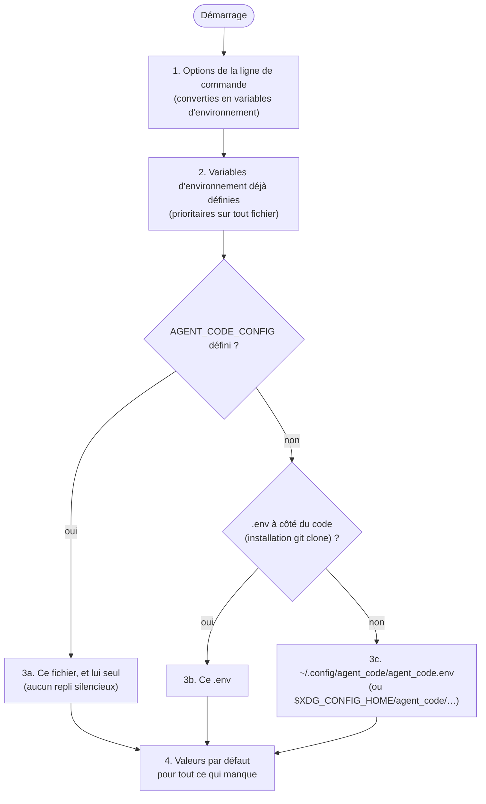

# 6. Configuration

[← Automatisation](05-automatisation.md) · [Sommaire](README.md) · [Architecture →](07-architecture.md)

## Table des matières

- [6.1 Où est lue la configuration ?](#61-où-est-lue-la-configuration-)
- [6.2 Format du fichier](#62-format-du-fichier)
- [6.3 Référence des variables](#63-référence-des-variables)
  - [Serveur Ollama](#serveur-ollama)
  - [Modèle](#modèle)
  - [Session](#session)
  - [Garde-fous](#garde-fous)
  - [Fonctionnalités](#fonctionnalités)
  - [Approbations automatiques](#approbations-automatiques)
- [6.4 Référence de la ligne de commande](#64-référence-de-la-ligne-de-commande)
- [6.5 Correspondance options ↔ variables](#65-correspondance-options--variables)
- [6.6 Fichiers et dossiers utilisés](#66-fichiers-et-dossiers-utilisés)
- [6.7 Profils de configuration types](#67-profils-de-configuration-types)

---

## 6.1 Où est lue la configuration ?



- **Le premier fichier trouvé gagne** ; les autres ne sont pas lus.
- Une variable déjà présente dans l'environnement n'est **jamais** écrasée par le fichier.
- Les options de la ligne de commande sont prioritaires sur tout.
- Le **`.env` du projet cible n'est jamais lu** : il appartient au projet, pas à agent_code (et il est
  d'ailleurs illisible par les agents).
- `agent_code --diagnostic` indique quel fichier a été chargé.

## 6.2 Format du fichier

Format `.env` simple :

```ini
# commentaire de ligne
AGENT_CODE_MODELE=qwen3-coder:30b
AGENT_CODE_CONTEXTE=32768          # commentaire de fin de ligne (précédé d'un espace)
export AGENT_CODE_WEB=true         # « export » accepté
AGENT_CODE_OLLAMA_API_KEY="abc#123"   # entre guillemets, le # est conservé
```

| Type | Valeurs acceptées |
|---|---|
| Booléen | vrai : `1`, `true`, `oui`, `yes`, `on`, `vrai` — tout le reste = faux ; vide = valeur par défaut |
| Entier / décimal | Valeur invalide → avertissement et valeur par défaut ; valeurs bornées (min/max ci-dessous) |
| Liste | Éléments séparés par des virgules ; chaque élément découpé comme en shell (`npm run lint`) |

## 6.3 Référence des variables

### Serveur Ollama

| Variable | Défaut | Description |
|---|---|---|
| `AGENT_CODE_OLLAMA_URL` | `http://localhost:11434` | Adresse du serveur Ollama. Doit être `http(s)://hôte[:port]` ; sinon remplacée par la valeur par défaut avec un avertissement. |
| `AGENT_CODE_OLLAMA_API_KEY` | *(vide)* | Clé envoyée en `Authorization: Bearer …` (Ollama derrière un reverse proxy). |
| `AGENT_CODE_OLLAMA_DE_CONFIANCE` | `false` | Ollama distant mais maîtrisé (Docker compose, LAN, VPN) : supprime l'alerte de confidentialité. Est considéré local : `localhost`, `127.0.0.1`, `::1`, `*.localhost`. |

### Modèle

| Variable | Défaut | Bornes | Description |
|---|---|---|---|
| `AGENT_CODE_MODELE` | `qwen3-coder:30b` | — | Modèle unique pour tous les rôles. Doit avoir la capacité `tools`. |
| `AGENT_CODE_MODELE_CODE` | = `MODELE` | — | Modèle de l'agent principal, des sous-agents de session et des rôles « code » des missions (développeur, testeur, devops, débogueur). |
| `AGENT_CODE_MODELE_REFLEXION` | = `MODELE` | — | Modèle des rôles « réflexion » des missions (architecte, relecteur, sécurité, documentaliste, chef de projet, chercheur) et des sous-agents de mission. ⚠️ Deux modèles différents = Ollama les alterne en mémoire (lent). |
| `AGENT_CODE_CONTEXTE` | `32768` | 4 096 – 262 144 | Fenêtre de contexte (`num_ctx`) envoyée à chaque requête, en tokens. Plus grand = plus de mémoire de travail mais plus de RAM (≈ 3,2 Go pour 32k avec qwen3-coder:30b). |
| `AGENT_CODE_TEMPERATURE_CODE` | `0.3` | 0 – 2 | Température des rôles « code » (basse = appels d'outils plus fiables). |
| `AGENT_CODE_TEMPERATURE_REFLEXION` | `0.5` | 0 – 2 | Température des rôles « réflexion ». |
| `AGENT_CODE_GARDER_MODELE` | `30m` | — | Durée pendant laquelle Ollama garde le modèle chargé après usage (`keep_alive`). |

### Session

| Variable | Défaut | Bornes | Description |
|---|---|---|---|
| `AGENT_CODE_MODE` | `normal` | `normal` · `auto` · `lecture` | Mode de départ (voir [Guide › Modes](03-guide-utilisateur.md#34-les-trois-modes)). |
| `AGENT_CODE_MAX_ETAPES` | `50` | 5 – 300 | Nombre maximal d'appels au modèle par demande (anti-boucle). Atteint : l'agent fait un point d'étape sans outils. |

### Garde-fous

| Variable | Défaut | Bornes | Description |
|---|---|---|---|
| `AGENT_CODE_TIMEOUT_CMD` | `120` | ≥ 5 | Secondes max par commande. Les tests ont au minimum 300 s. Les commandes `!` de l'utilisateur ont 5× cette valeur. |
| `AGENT_CODE_TIMEOUT_LLM` | `900` | ≥ 30 | Secondes max d'attente d'une réponse du modèle. |
| `AGENT_CODE_TIMEOUT_MISSION` | `0` | ≥ 0 | Secondes max pour une mission entière (`0` = illimité ; conseillé en cron : `3600`). |
| `AGENT_CODE_MAX_SORTIE` | `12000` | ≥ 2 000 | Caractères max renvoyés au modèle par un outil (au-delà : début + fin conservés). |

### Fonctionnalités

| Variable | Défaut | Description |
|---|---|---|
| `AGENT_CODE_WEB` | `true` | Recherche web : outils `Recherche_Web` / `Lire_Page_Web`, sous-agent `chercheur`, missions `veille` (requis) et `projet`. |
| `AGENT_CODE_AUTO_APPROUVER_SURES` | `true` | Les commandes d'inspection (`ls`, `git status`, `grep`…) passent sans validation. `false` = tout est validé. |
| `AGENT_CODE_VERBOSE` | `true` | `false` : pendant les missions, le texte des agents n'est pas affiché (seuls leurs actions, le bilan et le rapport). Équivaut à `--silencieux`. |

### Approbations automatiques

Utile sans surveillance (cron, CI, serveur). Les commandes **bloquées** le restent quoi qu'il arrive.

| Variable | Défaut | Description |
|---|---|---|
| `AGENT_CODE_AUTORISER_TESTS` | `false` | `Lancer_Tests` sans validation. ⚠️ Exécute le code du projet. |
| `AGENT_CODE_COMMANDES_AUTORISEES` | *(vide)* | Préfixes exacts acceptés sans validation, séparés par des virgules : `pytest, npm run lint, make check`. |
| `AGENT_CODE_AUTORISER_PAGES_WEB` | `false` | `Lire_Page_Web` sans validation. |

Autres variables lues :

| Variable | Rôle |
|---|---|
| `AGENT_CODE_CONFIG` | Chemin explicite du fichier de configuration |
| `XDG_CONFIG_HOME` | Base du dossier de configuration (défaut `~/.config`) |
| `XDG_DATA_HOME` | Base du dossier de l'historique de saisie (défaut `~/.local/share`) |

## 6.4 Référence de la ligne de commande

```
agent_code [dossier] [options]
```

| Option | Description |
|---|---|
| `dossier` | Projet cible (bac à sable). Défaut : dossier courant. |
| `-p`, `--prompt DEMANDE` | Une seule demande, réponse sur la sortie standard, puis quitte. |
| `-c`, `--continuer` | Reprend la dernière conversation du projet (session interactive). |
| `--mode {normal,auto,lecture}` | Mode de départ (défaut : `AGENT_CODE_MODE`). |
| `--modele NOM` | Modèle Ollama pour cette exécution (remplace les trois variables de modèle). |
| `-m`, `--mission CLÉ` | Lance une mission : `debug`, `dev`, `devops`, `doc`, `explique`, `projet`, `question`, `revue`, `tests`, `veille`. |
| `-t`, `--tache TEXTE` | La demande (mission, ou première demande d'une session interactive). |
| `-T`, `--tache-fichier FICHIER` | Lit la demande dans un fichier (`-` = entrée standard ; désactive alors les validations). Exclusif avec `-t`. |
| `--lecture-seule` | Interdit toute écriture et exécution de code, pour toute l'exécution. |
| `--branche` | Mission : isole les modifications dans une branche `agent_code/<mission>-<date>`. |
| `--sans-web` | Désactive la recherche web. |
| `--silencieux` | Missions : masque le texte des agents (seuls leurs actions et le rapport s'affichent). |
| `--confirmer-tout` | Demande validation même pour les commandes d'inspection. |
| `--autoriser-tests` | Lance les tests sans validation. |
| `--autoriser-cmd CMD` | Préfixe de commande accepté sans validation (répétable). S'ajoute à `AGENT_CODE_COMMANDES_AUTORISEES`. |
| `--timeout-mission SECONDES` | Durée max d'une mission (`0` = illimité). |
| `--json` | Écrit un résumé JSON en dernière ligne. |
| `--liste` | Affiche les missions disponibles et quitte. |
| `--diagnostic` | Vérifie l'installation et quitte (code 1 si erreur). |
| `--init-config` | Crée `~/.config/agent_code/agent_code.env` (ne remplace jamais un fichier existant) et quitte. |
| `--version` | Affiche la version. |
| `-h`, `--help` | Aide. |

## 6.5 Correspondance options ↔ variables

| Option | Variable positionnée |
|---|---|
| `--sans-web` | `AGENT_CODE_WEB=false` |
| `--modele X` | `AGENT_CODE_MODELE`, `AGENT_CODE_MODELE_CODE`, `AGENT_CODE_MODELE_REFLEXION` = `X` |
| `--mode X` | `AGENT_CODE_MODE=X` |
| `--silencieux` | `AGENT_CODE_VERBOSE=false` |
| `--timeout-mission N` | `AGENT_CODE_TIMEOUT_MISSION=N` |
| `--autoriser-tests` | `AGENT_CODE_AUTORISER_TESTS=true` |
| `--autoriser-cmd C` | ajoute `C` à `AGENT_CODE_COMMANDES_AUTORISEES` |
| `--confirmer-tout` | désactive `AGENT_CODE_AUTO_APPROUVER_SURES` pour l'exécution |

## 6.6 Fichiers et dossiers utilisés

**Sur ta machine** :

| Chemin | Contenu |
|---|---|
| `~/.config/agent_code/agent_code.env` | Configuration (créée par `--init-config`, permissions `600`) |
| `~/.local/share/agent_code/historique` | Historique des demandes tapées (flèches ↑/↓) |
| `~/.local/bin/agent_code` | Commande installée par pipx/uv |

**Dans chaque projet** :

| Chemin | Contenu | Créé par |
|---|---|---|
| `AGENT_CODE.md` | Mémoire du projet (stack, commandes, conventions), relue à chaque session | `/init` ou toi |
| `.agent_code/` | Dossier de travail, **exclu de git** automatiquement (`.git/info/exclude`) et **non modifiable** par les agents | agent_code |
| `.agent_code/audit.log` | Journal d'audit (JSON Lines), rotation à 5 Mo vers `audit.log.1` | agent_code |
| `.agent_code/sessions/*.json` | Conversations sauvegardées (50 dernières) | session interactive et `-p` |
| `.agent_code/rapports/*.md` | Rapports de mission | missions |
| `.agent_code/notes.md` | Notes durables (`/memo`, `Noter_Memo`), 200 Ko max | `/memo` et agents |
| `.agent_code/verrou` | Verrou d'exécution (pid et date de l'exécution en cours) | `-p` et missions |

**Dans le dépôt d'agent_code** :

| Fichier | Rôle |
|---|---|
| `.env.example` / `agent_code/defaut.env` | Modèle de configuration commenté (identiques) |
| `.env` | Configuration locale (installation « git clone ») — ignorée par git |

## 6.7 Profils de configuration types

**Poste de travail, 32 Go** (défauts) :

```ini
AGENT_CODE_MODELE=qwen3-coder:30b
AGENT_CODE_CONTEXTE=32768
AGENT_CODE_MODE=normal
```

**Machine plus modeste (16–24 Go)** :

```ini
AGENT_CODE_MODELE=qwen3-coder:30b      # ou gpt-oss:20b sur 16 Go
AGENT_CODE_CONTEXTE=16384
AGENT_CODE_GARDER_MODELE=10m           # libère la RAM plus vite
```

**Serveur d'audit sans surveillance** :

```ini
AGENT_CODE_WEB=false
AGENT_CODE_TIMEOUT_MISSION=3600
AGENT_CODE_AUTORISER_TESTS=false
AGENT_CODE_COMMANDES_AUTORISEES=ruff check
```

**Ollama sur un serveur GPU du réseau** :

```ini
AGENT_CODE_OLLAMA_URL=http://gpu.maison.lan:11434
AGENT_CODE_OLLAMA_DE_CONFIANCE=true
AGENT_CODE_CONTEXTE=65536
```

---

[← Automatisation](05-automatisation.md) · [Sommaire](README.md) · [Architecture →](07-architecture.md)
