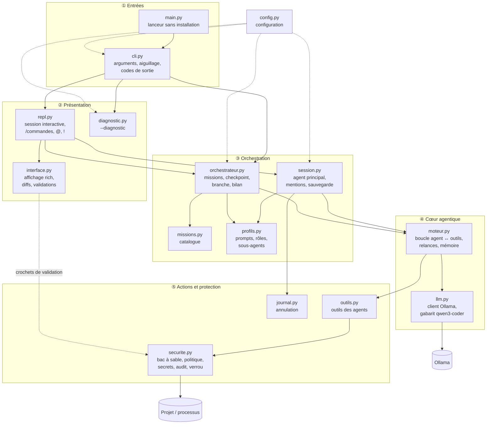
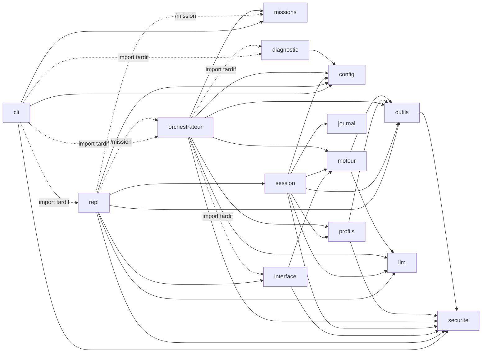
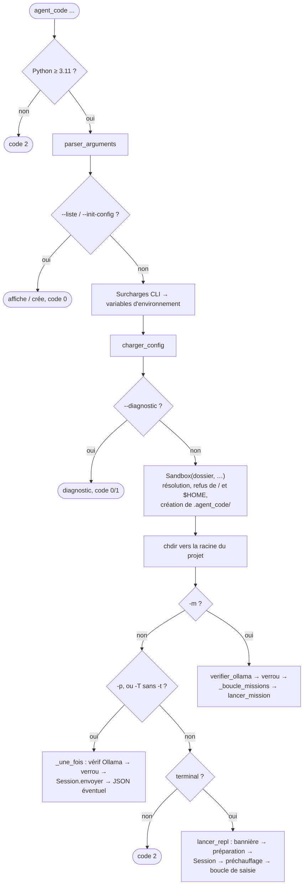
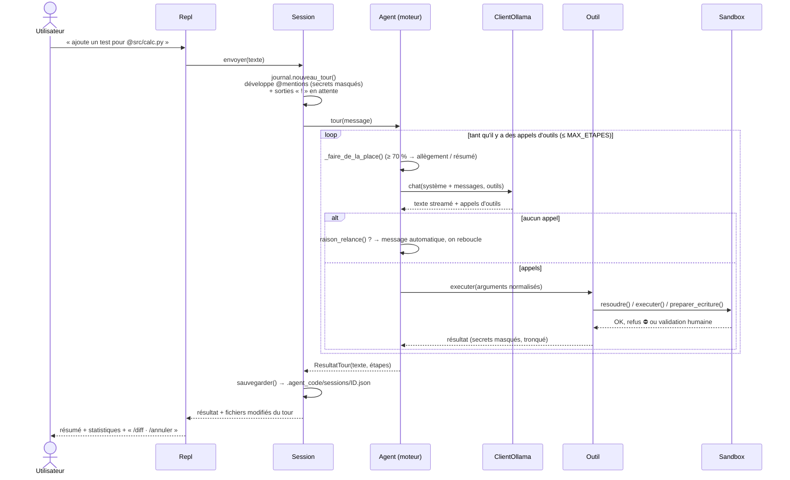
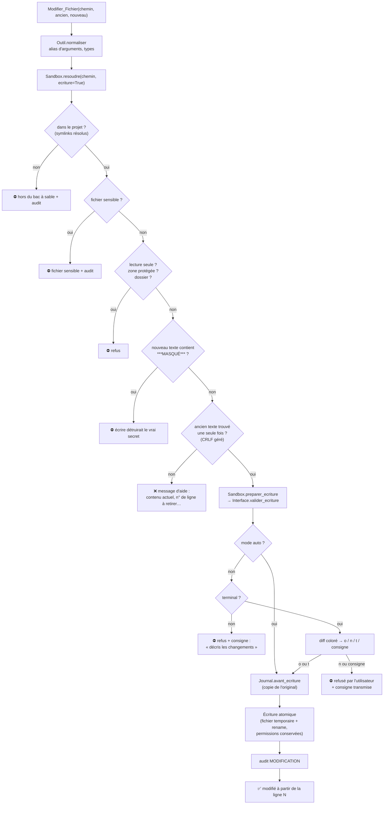
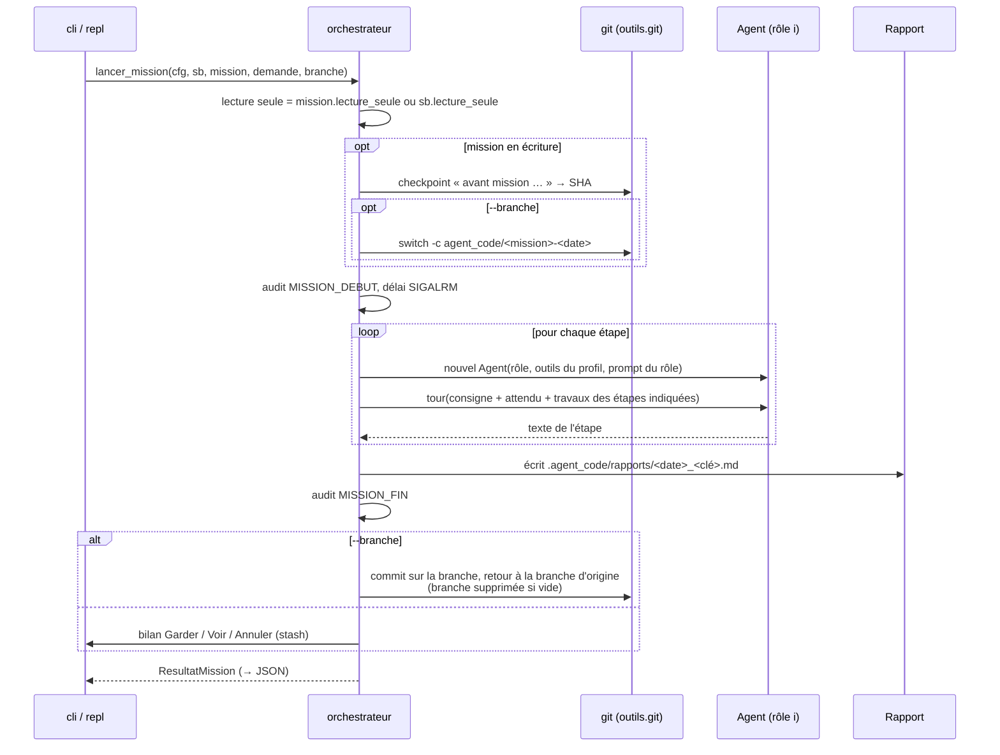
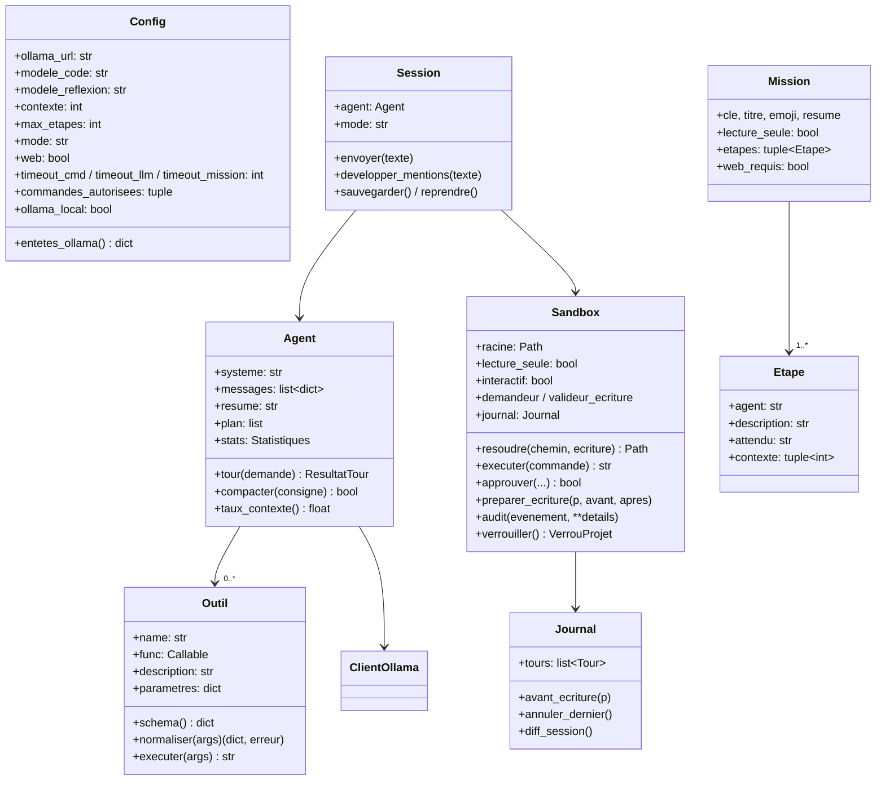

# 7. Architecture

[← Configuration](06-configuration.md) · [Sommaire](README.md) · [Moteur agentique →](08-moteur-agentique.md)

## Table des matières

- [7.1 Principes de conception](#71-principes-de-conception)
- [7.2 Vue d'ensemble en couches](#72-vue-densemble-en-couches)
- [7.3 Les modules un par un](#73-les-modules-un-par-un)
- [7.4 Graphe des dépendances](#74-graphe-des-dépendances)
- [7.5 Flux 1 : démarrage et aiguillage](#75-flux-1--démarrage-et-aiguillage)
- [7.6 Flux 2 : un tour de session interactive](#76-flux-2--un-tour-de-session-interactive)
- [7.7 Flux 3 : une écriture de fichier](#77-flux-3--une-écriture-de-fichier)
- [7.8 Flux 4 : une mission](#78-flux-4--une-mission)
- [7.9 Structures de données clés](#79-structures-de-données-clés)
- [7.10 Le découplage moteur ↔ interface](#710-le-découplage-moteur--interface)
- [7.11 Concurrence et signaux](#711-concurrence-et-signaux)

---

## 7.1 Principes de conception

| Principe | Mise en œuvre |
|---|---|
| **Bibliothèque standard d'abord** | Le moteur, le client Ollama, la sécurité, la configuration et le diagnostic n'importent que la stdlib. `rich` et `prompt_toolkit` ne servent qu'à l'interface, avec repli si absents. Démarrage instantané, installation légère. |
| **Le code décide, le modèle propose** | Le modèle ne fait que *demander* des actions. Toute vérification (chemins, commandes, secrets, validation humaine, git de sauvegarde) est faite par du code déterministe. |
| **Moindre privilège** | Chaque agent reçoit uniquement les outils de son rôle ; le mode lecture retire les outils d'écriture. |
| **Défense en profondeur** | Plusieurs barrières indépendantes : bac à sable, politique de commandes, environnement nettoyé, masquage de secrets, validation, audit. |
| **Tolérance aux faiblesses du modèle local** | Relances ciblées, analyse des appels d'outils écrits en texte, anti-boucle, résumé automatique, gabarit de prompt d'entraînement. |
| **Rien de perdu** | Écritures atomiques, journal d'annulation, checkpoint git, rapport même en cas d'échec, sauvegarde de la conversation à chaque tour. |
| **Testable sans Ollama** | Faux serveur HTTP et faux client pour les 106 tests. |

## 7.2 Vue d'ensemble en couches



## 7.3 Les modules un par un

| Module | Lignes | Responsabilité | Éléments principaux |
|---|---:|---|---|
| `cli.py` | ~320 | Point d'entrée : analyse les arguments, applique les surcharges de configuration, construit la `Sandbox`, aiguille vers session / demande unique / mission, gère le verrou et les codes de sortie | `main()`, `point_entree()`, `_une_fois()`, `_boucle_missions()` |
| `config.py` | ~190 | Lecture du `.env`, ordre de recherche, conversion et bornage des valeurs | `Config` (dataclass figée), `charger_config()`, `parser_dotenv()` |
| `repl.py` | ~620 | Session interactive : saisie (prompt_toolkit), complétion, barre d'état, commandes `/`, commandes `!`, préparation (téléchargement du modèle) | `Repl`, `Saisie`, `_Completeur`, `executer_une_fois()` |
| `interface.py` | ~310 | Affichage terminal et validations humaines ; implémente `Evenements` | `Interface` (spinner, diffs, panneaux, plan, réponses o/n/t/consigne) |
| `session.py` | ~190 | Assemble l'agent principal, ses sous-agents et le journal ; développe les `@mentions` ; sauvegarde/reprise ; préchauffage | `Session` |
| `moteur.py` | ~450 | Boucle agentique : appel du modèle, exécution des outils, relances, anti-boucle, plan, délégation, gestion du contexte, interruption | `Agent`, `ReglagesAgent`, `Evenements`, `FiltreAppels`, `raison_relance()` |
| `llm.py` | ~360 | Client HTTP Ollama (stdlib) : `/api/chat` ou mode brut `/api/generate` au format qwen3-coder ; streaming ; extraction des appels d'outils écrits en texte | `ClientOllama`, `rendre_qwen3coder()`, `extraire_appels_texte()` |
| `profils.py` | ~270 | Prompts système : règles communes, agent principal, consignes par mode, sous-agents, rôles de mission ; contexte du projet | `contexte_session()`, `prompt_principal()`, `SOUS_AGENTS`, `DEFINITIONS` |
| `outils.py` | ~900 | Les outils des agents et leurs boîtes par profil ; git déterministe (checkpoint) | `Outil`, `@tool`, `boite()`, `faire_checkpoint()`, `git()` |
| `journal.py` | ~120 | Mémorise le contenu d'origine des fichiers écrits, tour par tour ; `/annuler`, `/diff` | `Journal`, `Tour` |
| `securite.py` | ~690 | Bac à sable des chemins, politique de commandes, exécution de processus, environnement nettoyé, masquage des secrets, validation, audit, verrou | `Sandbox`, `analyser_commande()`, `rediger_secrets()`, `VerrouProjet` |
| `missions.py` | ~200 | Catalogue déclaratif des missions | `Mission`, `Etape`, `MISSIONS` |
| `orchestrateur.py` | ~350 | Exécution d'une mission : checkpoint, branche, enchaînement des étapes, délai, rapport, bilan | `lancer_mission()`, `ResultatMission`, `delai_max()` |
| `diagnostic.py` | ~200 | Vérification de l'installation (stdlib uniquement) ; estimation de la mémoire du cache KV | `diagnostic_complet()`, `etat_ollama()`, `memoire_kv_go()` |

## 7.4 Graphe des dépendances



Les imports « tardifs » (dans le corps des fonctions) gardent le démarrage rapide : `--version`, `--liste`,
`--init-config` et `--diagnostic` n'importent ni `rich` ni `prompt_toolkit`, et le diagnostic fonctionne même
si une dépendance manque.

## 7.5 Flux 1 : démarrage et aiguillage



## 7.6 Flux 2 : un tour de session interactive



## 7.7 Flux 3 : une écriture de fichier

C'est le chemin le plus protégé. Exemple avec `Modifier_Fichier` :



## 7.8 Flux 4 : une mission



## 7.9 Structures de données clés



**Format des messages** (identique à l'API `/api/chat` d'Ollama) :

```python
{"role": "system",    "content": "…prompt système…"}                     # ajouté à chaque appel
{"role": "user",      "content": "ajoute un test…"}
{"role": "assistant", "content": "", "tool_calls": [
    {"function": {"name": "Lire_Fichier", "arguments": {"chemin": "calc.py"}}}]}
{"role": "tool",      "tool_name": "Lire_Fichier", "content": "📄 calc.py (lignes 1-9 / 9)…"}
```

**Conversation sauvegardée** (`.agent_code/sessions/<id>.json`) :

```json
{"id": "2026-11-10_143000_a1b2", "modele": "qwen3-coder:30b", "mode": "normal",
 "titre": "ajoute un test pour calc.py", "maj": "2026-11-10T14:32:11",
 "messages": [...], "resume": "", "plan": [["fait", "lire calc.py"]]}
```

**Ligne du journal d'audit** (`.agent_code/audit.log`, JSON Lines, secrets masqués) :

```json
{"ts": "2026-11-10T14:31:02", "evt": "COMMANDE", "commande": "pytest -q", "verdict": "confirmer", "raison": "commande avec effets de bord possibles"}
```

## 7.10 Le découplage moteur ↔ interface

Le moteur ne sait rien de l'affichage : il émet des **événements** via la classe `Evenements`, dont toutes
les méthodes sont vides par défaut. `Interface` les surcharge pour dessiner l'écran.

| Événement | Émis quand | Rendu par `Interface` |
|---|---|---|
| `debut_reflexion()` | Avant chaque appel au modèle | Spinner « Réflexion… Ns » |
| `texte(morceau)` | Pour chaque fragment de texte streamé (appels d'outils filtrés par `FiltreAppels`) | Écriture directe dans le terminal |
| `fin_texte()` | Fin de la réponse | Arrêt du spinner, retour à la ligne |
| `outil_debut(nom, args)` | Avant un outil | `● Nom(résumé des arguments)` |
| `outil_fin(nom, args, résultat, durée)` | Après un outil | `⎿ première ligne` (rouge si erreur) |
| `plan(items)` | `Mettre_A_Jour_Plan` | Panneau 📋 Plan |
| `info(message)` | Information (résumé automatique…) | Ligne jaune |
| `sous_agent(nom, tâche)` | Création d'un sous-agent | Renvoie une `Interface` enfant indentée `│` (texte masqué) |
| `relance(raison, texte)` | Relance automatique | (non affiché) |

Dans l'autre sens, la `Sandbox` expose deux **crochets** que l'interface branche (`Interface.brancher(sb)`) :

- `sb.demandeur(titre, détails, genre, argv) -> bool | str` : validation d'une commande / des tests / d'une page web ;
- `sb.valideur_ecriture(chemin, avant, après) -> bool | str` : validation d'un diff.

Une réponse `str` signifie « refus + consigne ». Sans crochet, la `Sandbox` utilise une simple question
`(o/N)` dans le terminal. Ce découplage permet de tester le moteur avec un faux client et sans terminal.

## 7.11 Concurrence et signaux

| Mécanisme | Où | Pourquoi |
|---|---|---|
| Thread démon « prechauffage » | `Session.prechauffer()` | Charge le modèle et met en cache le prompt système pendant que l'utilisateur tape |
| `threading.RLock` | `Sandbox._verrou` | Sérialise les questions posées à l'utilisateur |
| `threading.Lock` | `Sandbox._verrou_audit` | Écritures concurrentes dans le journal d'audit |
| `fcntl.flock` | `VerrouProjet` | Exclusion entre **processus** (cron + humain) ; libéré par le noyau si le processus meurt |
| `SIGALRM` | `orchestrateur.delai_max()` | Délai global de mission ; lève `DelaiMissionDepasse`, une `BaseException` pour ne pas être avalée par les `except Exception` |
| `KeyboardInterrupt` | Moteur, outils, processus | Ctrl+C interrompt le tour ; les processus enfants sont tués ; l'historique est rendu cohérent |
| `start_new_session` + `killpg` | `executer_processus()` | Tue toute l'arborescence de processus d'une commande (petits-enfants compris) |

---

[← Configuration](06-configuration.md) · [Sommaire](README.md) · [Moteur agentique →](08-moteur-agentique.md)
