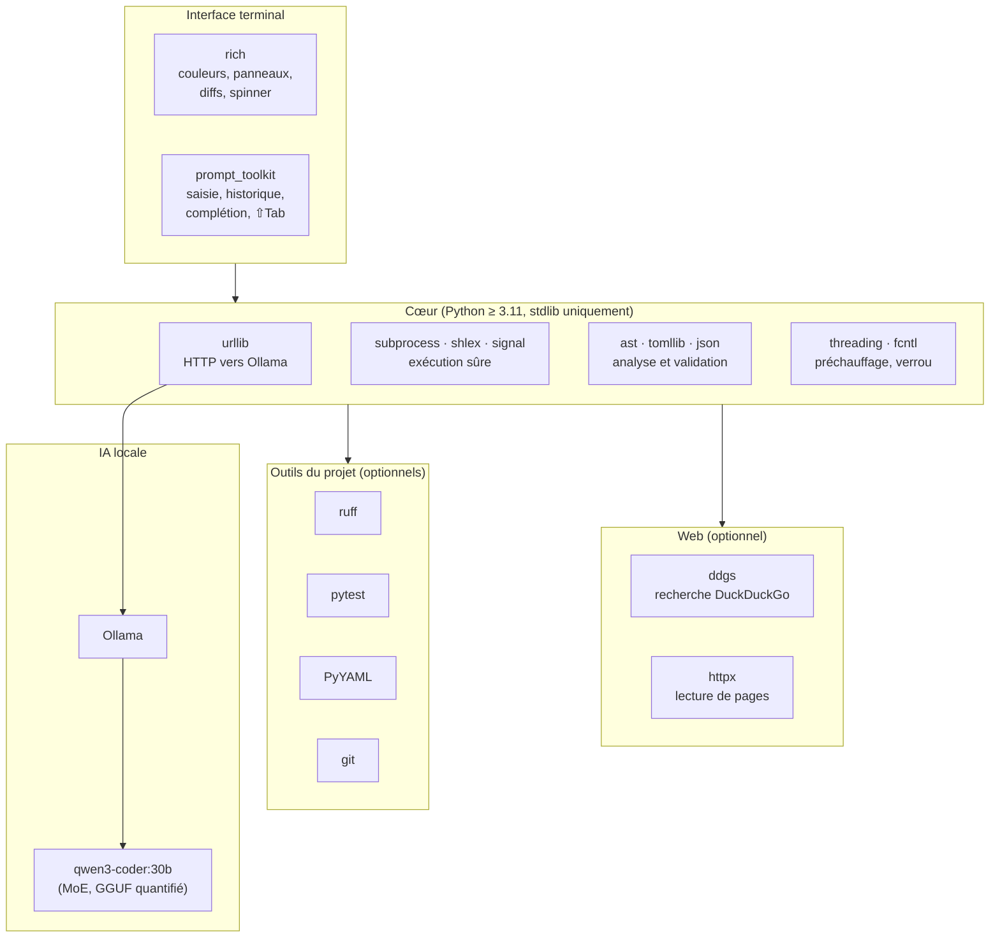
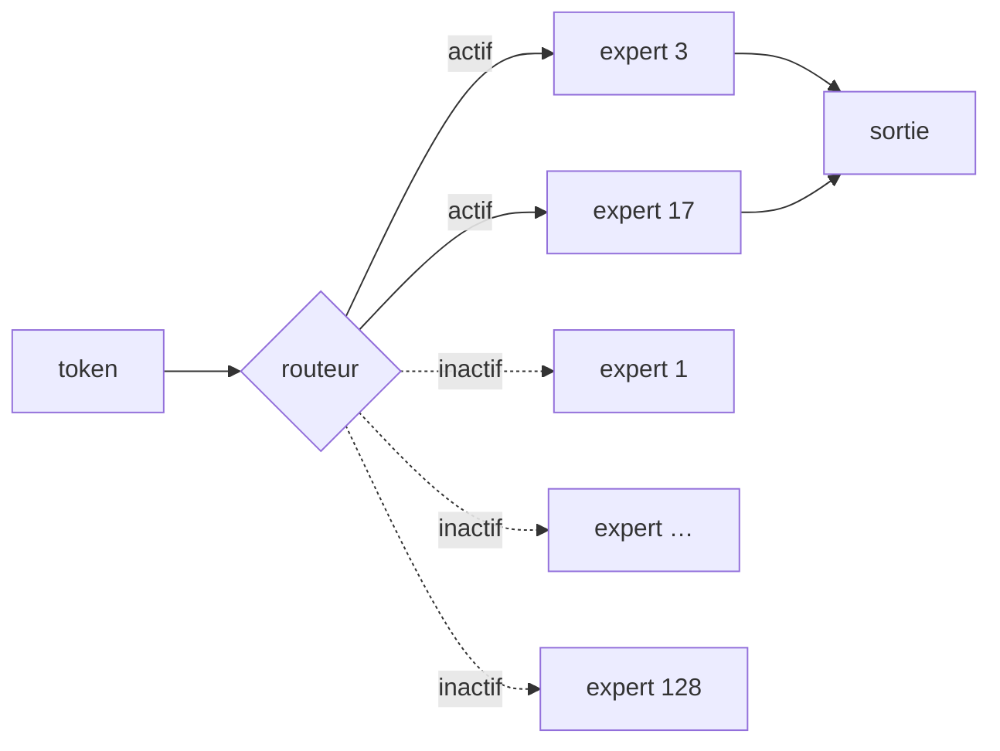

# 11. Technologies

[← Sécurité](10-securite.md) · [Sommaire](README.md) · [Développement →](12-developpement.md)

## Table des matières

- [11.1 La pile en un coup d'œil](#111-la-pile-en-un-coup-dœil)
- [11.2 Ollama](#112-ollama)
- [11.3 qwen3-coder et l'architecture MoE](#113-qwen3-coder-et-larchitecture-moe)
- [11.4 Tokens, fenêtre de contexte et cache KV](#114-tokens-fenêtre-de-contexte-et-cache-kv)
- [11.5 Appels d'outils (function calling)](#115-appels-doutils-function-calling)
- [11.6 ChatML et format d'entraînement](#116-chatml-et-format-dentraînement)
- [11.7 Python et sa bibliothèque standard](#117-python-et-sa-bibliothèque-standard)
- [11.8 Bibliothèques tierces](#118-bibliothèques-tierces)
- [11.9 Outils de la chaîne de développement](#119-outils-de-la-chaîne-de-développement)
- [11.10 Git](#1110-git)
- [11.11 Mécanismes du système (POSIX)](#1111-mécanismes-du-système-posix)
- [11.12 Déploiement : Docker, compose, systemd](#1112-déploiement--docker-compose-systemd)
- [11.13 Choix écartés et pourquoi](#1113-choix-écartés-et-pourquoi)

---

## 11.1 La pile en un coup d'œil



| Couche | Technologie | Version épinglée | Obligatoire ? |
|---|---|---|---|
| Langage | Python | ≥ 3.11 | ✔ |
| IA | Ollama + qwen3-coder:30b | — | ✔ |
| Affichage | rich | 14.3.4 | ✔ |
| Saisie | prompt_toolkit | 3.0.53 | recommandé (repli sur `input` + `readline`) |
| Recherche web | ddgs | 9.16.1 | si web |
| Pages web | httpx | 0.28.1 | si web |
| Analyse statique | ruff | 0.17.3 | optionnel (repli : compilation) |
| Validation YAML | PyYAML | 6.0.3 | optionnel |
| Tests Python | pytest | 9.2.0 | optionnel (repli : unittest) |
| Versionnement | git | — | fortement recommandé |
| Empaquetage | setuptools (pyproject.toml) | ≥ 69 | à l'installation |

## 11.2 Ollama

**Ce que c'est.** Un serveur local gratuit qui télécharge des modèles d'IA (au format GGUF, issu de
llama.cpp) et les expose via une API HTTP sur `localhost:11434`. Il gère la mémoire (chargement,
déchargement après `keep_alive`), le GPU s'il existe, et un **cache de préfixe** des prompts.

**Comment agent_code l'utilise.**

| Endpoint | Usage |
|---|---|
| `/api/chat` | Conversation avec outils (modèles autres que qwen3-coder) |
| `/api/generate` avec `raw: true` | Mode « brut » : prompt construit par agent_code (qwen3-coder) |
| `/api/tags`, `/api/show`, `/api/ps`, `/api/version` | Diagnostic, capacités, mémoire |
| `/api/pull` | Téléchargement du modèle avec progression |

**Pourquoi Ollama.** Installation en une commande, gestion automatique CPU/GPU, API simple et stable,
réglage de `num_ctx` à chaque requête, écosystème de modèles très large.

## 11.3 qwen3-coder et l'architecture MoE

**Le modèle.** `qwen3-coder:30b` (famille Qwen3, Alibaba) est spécialisé en programmation et entraîné pour
les **appels d'outils** (usage agentique). Téléchargé quantifié, il pèse 18,6 Go.

**MoE (Mixture of Experts, « mélange d'experts »).** Un modèle classique (« dense ») utilise **tous** ses
paramètres pour chaque mot généré. Un modèle MoE est découpé en nombreux « experts » ; un petit **routeur**
choisit, pour chaque token, quelques experts seulement.



| | Dense 30B | MoE 30B (qwen3-coder:30b) |
|---|---|---|
| Paramètres stockés | 30 milliards | 30 milliards |
| Paramètres **actifs** par token | 30 milliards | ≈ 3 milliards |
| Mémoire nécessaire | ≈ 18 Go (quantifié) | ≈ 18 Go (quantifié) |
| Calcul par token | ×10 | ×1 |
| Utilisable sur CPU | difficilement | **oui** (≈ 16 tokens/s) |

C'est ce qui permet un agent de qualité sur un ordinateur portable sans carte graphique : il faut la
**mémoire** d'un gros modèle, mais seulement le **calcul** d'un petit.

**Quantification.** Les poids sont stockés sur ≈ 4 bits au lieu de 16 : 4× moins de mémoire, perte de
qualité faible.

**Alternatives.** Tout modèle Ollama avec la capacité `tools` fonctionne (via `/api/chat`). Exemple plus
léger : `gpt-oss:20b` (≈ 14 Go).

## 11.4 Tokens, fenêtre de contexte et cache KV

**Token.** Le modèle découpe le texte en morceaux (≈ 3 à 4 caractères en moyenne ; agent_code estime
prudemment 3,2 pour un mélange de code et de français). Toutes les limites et vitesses s'expriment en tokens.

**Fenêtre de contexte** (`num_ctx`). Nombre maximal de tokens que le modèle peut prendre en compte en même
temps : prompt système + historique + schémas d'outils + réponse. agent_code demande 32 768 tokens par défaut
et la gère activement (allègement, résumé : [Moteur](08-moteur-agentique.md#87-gestion-de-la-mémoire-de-travail)).

**Cache KV.** Pendant le calcul, le modèle garde pour chaque token et chaque couche deux vecteurs (« Key » et
« Value ») : c'est le **cache KV**. Sa taille croît linéairement avec la fenêtre. agent_code la calcule dans le
diagnostic à partir des métadonnées du modèle (`/api/show`) :

```
mémoire KV (octets) = 2 (K et V) × couches × têtes_KV × dimension_tête × 2 octets (f16) × num_ctx
```

Pour qwen3-coder:30b et 32 768 tokens : ≈ 3,2 Go, d'où ≈ 22 Go au total. Diviser le contexte par deux divise
cette part par deux.

**Lecture du prompt vs génération.** Deux vitesses distinctes : la lecture (« prompt eval ») traite les
tokens d'entrée (≈ 100 tokens/s sur CPU), la génération (« eval ») produit les tokens de sortie
(≈ 16 tokens/s). Le **cache de préfixe** d'Ollama évite de relire un début de prompt identique : d'où
l'importance d'un prompt système stable et du préchauffage.

## 11.5 Appels d'outils (function calling)

Principe : on fournit au modèle une liste d'outils décrits en **JSON Schema** (nom, description, paramètres
typés, paramètres requis). Un modèle entraîné pour cela peut répondre, au lieu de texte, par un objet
structuré « appelle l'outil X avec les arguments Y ». Le programme exécute, renvoie le résultat
(`role: tool`), et le modèle continue. C'est la base de tout agent moderne (Claude Code, Copilot, Cursor…).

agent_code génère les schémas automatiquement à partir des signatures Python (voir
[Moteur › Définir un outil](08-moteur-agentique.md#83-définir-un-outil--du-python-au-schéma-json)).

## 11.6 ChatML et format d'entraînement

Un modèle de chat ne voit en réalité qu'un **long texte** ; les rôles (système, utilisateur, assistant) y sont
délimités par des balises spéciales. Qwen utilise **ChatML** :

```
<|im_start|>system
…<|im_end|>
<|im_start|>user
…<|im_end|>
<|im_start|>assistant
```

qwen3-coder représente ses appels d'outils en **XML** (`<tool_call><function=…><parameter=…>`) et leurs
résultats dans `<tool_response>`. Plus le prompt ressemble exactement à ce que le modèle a vu à l'entraînement,
plus il est fiable. C'est pourquoi agent_code construit lui-même ce format pour qwen3-coder
([mode brut](08-moteur-agentique.md#811-le-mode--brut--qwen3-coder)).

## 11.7 Python et sa bibliothèque standard

Le cœur d'agent_code n'utilise **que la bibliothèque standard**. Les modules clés :

| Module | Usage dans agent_code |
|---|---|
| `urllib.request` | Client HTTP Ollama, streaming ligne par ligne, sans proxy |
| `json` | Messages, schémas d'outils, sessions, audit |
| `subprocess` | Exécution des commandes sans shell, nouvelle session de processus |
| `shlex` | Découpage sûr des commandes (comme le shell, sans l'exécuter) |
| `signal` | `SIGALRM` (délai de mission), `SIGKILL` sur le groupe de processus |
| `os` / `pathlib` | Résolution des chemins (`resolve()`, `is_relative_to()`), parcours sans suivre les liens, écriture atomique (`os.replace`) |
| `fcntl` | Verrou `flock` de projet |
| `threading` | Préchauffage en arrière-plan, verrous internes |
| `tempfile` | Sorties de processus, écritures atomiques |
| `ast` | Extraction des signatures Python |
| `tomllib` | Validation TOML (Python ≥ 3.11 — raison de la version minimale) |
| `re` / `fnmatch` | Politique de commandes, secrets, motifs de fichiers, analyse des appels textuels |
| `difflib` | Diffs affichés et `/diff` |
| `ipaddress` / `socket` | Protection SSRF |
| `inspect` | Génération des schémas d'outils depuis les signatures |
| `dataclasses` / `enum` | Structures de données (`Config`, `Mission`, `Verdict`…) |
| `argparse` | Ligne de commande |
| `importlib.metadata` | Versions des paquets (diagnostic) |
| `unittest` / `http.server` | Tests et faux serveur Ollama |

**Pourquoi ce choix ?** Démarrage instantané, installation légère, aucune dépendance lourde à auditer pour la
partie critique (sécurité, exécution), fonctionnement du diagnostic même si une dépendance manque.

## 11.8 Bibliothèques tierces

| Bibliothèque | Rôle | Si absente |
|---|---|---|
| **rich** | Rendu terminal : texte stylé (balisage `[bold]…[/]`), panneaux, diffs colorés, coloration syntaxique de `/diff`, spinner animé (`Live`), barre de progression du téléchargement, tableaux | Affichage texte brut minimal (le diagnostic la signale comme erreur) |
| **prompt_toolkit** | Saisie avancée : historique persistant, complétion des `/commandes` et `@chemins`, raccourci ⇧Tab, Échap+Entrée, barre d'état dynamique | Repli sur `input()` + `readline` |
| **ddgs** | Recherche DuckDuckGo sans clé d'API | `Recherche_Web` renvoie une erreur |
| **httpx** | Client HTTP pour `Lire_Page_Web` : streaming, délai, désactivation des proxys (`trust_env=False`), redirections non suivies | `Lire_Page_Web` renvoie une erreur |

Versions **épinglées** dans `pyproject.toml` et `requirements.txt` (reproductibilité, chaîne d'approvisionnement).

## 11.9 Outils de la chaîne de développement

| Outil | Usage |
|---|---|
| **ruff** | Linter Python ultra-rapide (Rust). Utilisé par l'outil `Analyser_Qualite` et par `make lint`. Configuré dans `pyproject.toml` (longueur de ligne 120, cible py311) |
| **pytest** | Lancé par `Lancer_Tests` sur les projets Python s'il est importable ; sinon `unittest` |
| **PyYAML** | `Verifier_Syntaxe` sur les fichiers YAML (`safe_load_all`, jamais de chargement dangereux) |
| **unittest** | Framework des tests d'agent_code lui-même (`make test`) |
| **pipx / uv** | Installation de la commande dans un environnement isolé (`make installer`) |
| **setuptools** | Construction du paquet (`pyproject.toml`, point d'entrée `agent_code = agent_code.cli:point_entree`, `defaut.env` inclus comme donnée) |
| **Make** | Raccourcis : `installer`, `dev`, `test`, `lint`, `diagnostic`, `modeles`, `docker` |

## 11.10 Git

Rôle central dans le filet de sécurité :

| Usage | Commandes git |
|---|---|
| Checkpoint avant mission | `add -A -- . :(exclude)…`, `commit --no-verify --no-gpg-sign` |
| Bilan / annulation | `diff --stat`, `ls-files --others`, `stash push -u` |
| Mode branche | `switch -c`, `switch`, `branch -D` (si vide) |
| Contexte du projet | `branch --show-current`, `status --porcelain`, `log --oneline -5` |
| Outils des agents | `status -sb`, `log`, `diff --no-ext-diff --no-textconv` |
| Exclusion de `.agent_code/` | écriture dans `.git/info/exclude` (pas de modification du `.gitignore`) |
| `/commit` | `add`, `commit -F -` (avec tes hooks) |

Les **pathspecs magiques** `:(exclude,glob)**/.env` permettent d'exclure les fichiers sensibles de chaque
opération ; les options `-c core.hooksPath=/dev/null`, `core.fsmonitor=false`, `core.pager=cat` empêchent
toute exécution de code par le dépôt.

## 11.11 Mécanismes du système (POSIX)

| Mécanisme | Usage | Pourquoi |
|---|---|---|
| **Groupe de processus** (`setsid` via `start_new_session`) + `killpg` | Exécution des commandes | Tuer toute l'arborescence d'une commande au délai |
| **`flock`** (verrou consultatif) | `.agent_code/verrou` | Exclusion entre processus, libérée par le noyau si le processus meurt |
| **`SIGALRM`** (`signal.alarm`) | Délai de mission | Interrompre le thread principal au bout de N secondes |
| **`rename` atomique** (`os.replace`) | Écritures de fichiers | Un fichier est soit l'ancien, soit le nouveau, jamais à moitié écrit |
| **`isatty`** | Détection du mode sans surveillance | Refuser les validations sans terminal |
| **XDG Base Directory** | `~/.config/agent_code`, `~/.local/share/agent_code` | Emplacements standard |

Ces mécanismes expliquent pourquoi Windows natif n'est pas pris en charge (WSL ou Docker conviennent).

## 11.12 Déploiement : Docker, compose, systemd

| Technologie | Fichier | Rôle |
|---|---|---|
| **Docker** | `Dockerfile` | Image `python:3.12-slim` + git, utilisateur non-root à ton UID, `ENTRYPOINT ["agent_code"]` |
| **Docker Compose** | `docker-compose.yml` | Services `ollama` (healthcheck, volume des modèles, GPU optionnel), `ollama-init` (téléchargement unique du modèle), `agent_code` (profil `outil`, lancé à la demande, `cap_drop: ALL`) |
| **systemd** (service + timer utilisateur) | `deploy/systemd/` | Audit nocturne : timer `OnCalendar=*-*-* 03:00`, `Persistent=true`, `RandomizedDelaySec=15min` ; service `oneshot`, `Nice=10`, `IOSchedulingClass=idle`, `NoNewPrivileges=true` |
| **`loginctl enable-linger`** | — | Exécuter les services utilisateur même sans session ouverte |

## 11.13 Choix écartés et pourquoi

| Option écartée | Raison |
|---|---|
| **API compatible OpenAI d'Ollama** | Ne permet pas de régler `num_ctx` par requête |
| **Variantes de modèles « grand contexte »** (Modelfile) | Inutiles : `num_ctx` est envoyé à chaque requête |
| **Deux modèles (réflexion + code)** par défaut | Ollama doit les alterner en mémoire : très lent sur une machine grand public. Toujours possible via `AGENT_CODE_MODELE_REFLEXION` |
| **`shell=True`** | Ouvre la porte à l'injection de commandes |
| **Mémoire vectorielle (embeddings)** | Complexité et ressources ; remplacée par `AGENT_CODE.md`, les notes, le résumé automatique et les sous-agents |

---

[← Sécurité](10-securite.md) · [Sommaire](README.md) · [Développement →](12-developpement.md)
