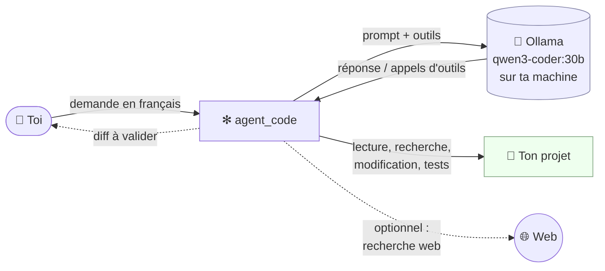

# 📚 Documentation d'agent_code

> **agent_code** est un assistant de programmation autonome qui tourne **entièrement sur ta machine**.
> Tu lui parles en français, il lit ton projet, modifie les fichiers (tu valides chaque changement),
> lance les tests et vérifie son travail. Ton code ne quitte jamais ton poste.

Cette documentation est organisée en deux parcours : un **parcours utilisateur** (aucune connaissance
technique de l'outil n'est requise) et un **parcours technique** (architecture, moteur, sécurité, contribution).

---

## Sommaire général

### 🧭 Parcours utilisateur

| # | Document | Pour qui ? | Contenu |
|---|---|---|---|
| 1 | [Présentation](01-presentation.md) | Tout le monde | Ce qu'est agent_code, à quoi il sert, pourquoi « 100 % local », glossaire |
| 2 | [Installation](02-installation.md) | Utilisateur | Prérequis, installation (pipx, uv, git, Docker), premier lancement |
| 3 | [Guide d'utilisation](03-guide-utilisateur.md) | Utilisateur | Session interactive, modes, commandes `/`, `@fichier`, `!commande`, annulation |
| 4 | [Missions et sous-agents](04-missions-et-sous-agents.md) | Utilisateur | Équipes d'agents spécialisés : dev, debug, revue, tests, doc… |
| 5 | [Automatisation](05-automatisation.md) | Utilisateur avancé | Scripts, cron, CI, serveur, Docker, systemd, JSON, codes de sortie |
| 6 | [Configuration](06-configuration.md) | Utilisateur avancé | Toutes les variables `AGENT_CODE_*`, toutes les options de la ligne de commande |
| 13 | [Dépannage et FAQ](13-depannage-faq.md) | Tout le monde | Problèmes fréquents et réponses aux questions courantes |

### 🛠️ Parcours technique

| # | Document | Contenu |
|---|---|---|
| 7 | [Architecture](07-architecture.md) | Vue d'ensemble, modules, schémas des flux, structures de données |
| 8 | [Moteur agentique](08-moteur-agentique.md) | Boucle agent ↔ outils, relances, gestion de la mémoire, client Ollama, format qwen3-coder |
| 9 | [Catalogue des outils](09-outils.md) | Chaque outil des agents : arguments, limites, comportements, profils |
| 10 | [Sécurité](10-securite.md) | Modèle de menace, bac à sable, politique de commandes, secrets, audit |
| 11 | [Technologies](11-technologies.md) | Chaque techno utilisée, expliquée et justifiée (Ollama, MoE, cache KV, rich…) |
| 12 | [Développement](12-developpement.md) | Structure du dépôt, tests, ajouter une mission / un outil / un sous-agent |

---

## Vue d'ensemble en un schéma

## Par où commencer ?

- **Tu découvres l'outil ?** → [Présentation](01-presentation.md), puis [Installation](02-installation.md).
- **Tu veux l'utiliser au quotidien ?** → [Guide d'utilisation](03-guide-utilisateur.md).
- **Tu veux l'automatiser (cron, CI, serveur) ?** → [Automatisation](05-automatisation.md).
- **Tu veux comprendre comment il fonctionne ?** → [Architecture](07-architecture.md), puis [Moteur](08-moteur-agentique.md).
- **Tu te poses des questions de sécurité ?** → [Sécurité](10-securite.md).
- **Tu veux contribuer ?** → [Développement](12-developpement.md).

## Conventions de cette documentation

| Notation | Signification |
|---|---|
| `agent_code` | la commande installée (ou `python main.py` sans installation) |
| `AGENT_CODE_XXX` | une variable de configuration (voir [Configuration](06-configuration.md)) |
| `Lire_Fichier` | un **outil** que le modèle peut appeler (voir [Outils](09-outils.md)) |
| `/commande` | une commande tapée dans la session interactive |
| `.agent_code/` | le dossier de travail qu'agent_code crée dans chaque projet |
| 🔴 / 🟠 / 🟢 | gravité : bloquant / important / suggestion |

Version documentée : **agent_code 1.0**.
